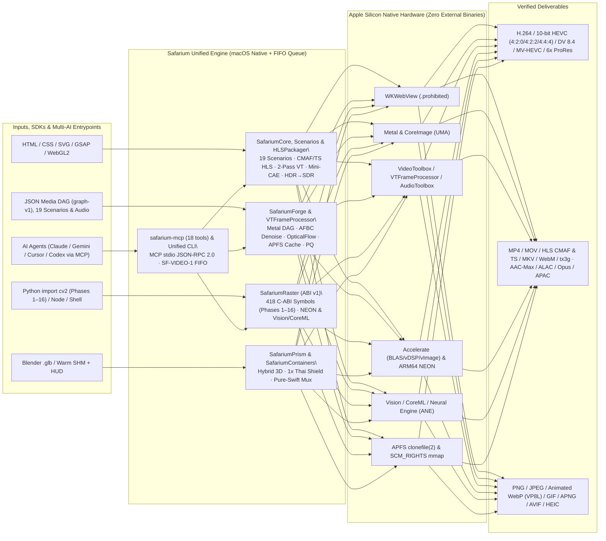

<div align="center">

# Safarium

**100% Native macOS Apple Silicon HTML, 3D, 2D Raster, and Media Rendering Engine — Built for Multi-AI Agents (`MCP`).**

[](https://github.com/sanookai/Safarium/actions/workflows/ci-macos.yml)
[](LICENSE)
[](#quick-start)
[](#verified-cloud-ci)
[](#why-safarium)
[-0969da)](#multi-ai-agent-integration-mcp)
[](#wave-10-every-video-encoding-scenario-apple-m5)
[](#3-image-processing-2d-raster--still-codecs)

<p>
  <a href="#why-safarium">Why Safarium?</a> •
  <a href="#wave-10-every-video-encoding-scenario-apple-m5">19 Scenarios & HLS</a> •
  <a href="#multi-ai-agent-integration-mcp">AI & MCP</a> •
  <a href="#at-a-glance-comparison">Comparisons</a> •
  <a href="#real-benchmarks-apple-m5">Benchmarks</a> •
  <a href="#honest-trade-offs--when-not-to-use-safarium">Honest Trade-Offs</a> •
  <a href="#architecture">Architecture</a> •
  <a href="#quick-start">Quick Start</a> •
  <a href="#documentation--research">Docs</a>
</p>

</div>

---

## Why Safarium?

Modern programmatic video, image, and AI-media pipelines typically glue together **Headless Chrome + FFmpeg + OpenCV + Blender**. On a Mac, that stack regularly burns **1.5–4+ GiB of RAM per job**, copies uncompressed frames across processes and disk, ships hundreds of megabytes of third-party binaries, and steals desktop focus or throttles your system.

**Safarium** goes **100% all-in on macOS & Apple Silicon** (no cross-platform compromises), replacing that entire toolchain with one unified native engine built strictly on **pre-installed macOS system frameworks** (`WKWebView`, `Metal`, `VideoToolbox`, `VTFrameProcessor`, `AudioToolbox`, `CoreImage`, `CoreML`, `Accelerate`, `Vision`/ANE, and `APFS`):

- **0% FFmpeg / ffprobe / libav**, **0% Chrome / Chromium / Playwright**, and **0% OpenCV** in production binaries (verified by `otool -L` against `/System/Library/*` and `/usr/lib/*` only).
- **Wave 10 Every Video Encoding Scenario (0% FFmpeg):** ships **19 one-flag scenario presets** (`--scenario youtube`, `youtube-4k`, `shorts`, `tiktok`, `reels`, `web-streaming`, `web-compat`, `screen-recording`, `cinema-master`, `cinema-vfx`, `transparent-vfx`, `hdr-dolby-vision`, `hdr10`, `spatial-visionos`, `archival`, `live-low-latency`, `podcast-video`, `webp-clip`, `gif-clip`), a **native HLS ABR ladder packager** (`.fmp4` CMAF via `AVAssetWriter` + `.ts` via pure-Swift 188-byte MPEG-TS muxer + WebVTT subtitles), **hardware HDR→SDR tone-mapping** (`CIToneMapHeadroom` + BT.709), and **direct video → Animated WebP / GIF / APNG** export.
- **Wave 9 Apple Silicon Encoding Supremacy (0% FFmpeg):** unlocks hardware capabilities **FFmpeg `hevc_videotoolbox` cannot even access** — **True 2-Pass `VTMultiPassStorage`** (`MS-SSIM 0.9939` at `3.55 Mbps`, **`6.9×` faster** than 2-pass `libx265` and **+0.020 MS-SSIM** above FFmpeg `hevc_videotoolbox`!), **10-bit HEVC (`4:2:0`/`4:2:2`/`4:4:4`)** with 4×4 Bayer dithering, **SpatialAQ + LookAhead + CQF + VBV**, **"Safarium Mini-CAE"** per-shot adaptive multi-engine chunking, zero-copy **`VTFrameProcessor`** (`VTTemporalNoiseFilter` AFBC hardware denoise, `VTFrameRateConversion` optical-flow retiming, `VTMotionBlur`), **Dolby Vision 8.4 / HDR10 / HLG / Apple Log**, **MV-HEVC Spatial Video**, all **6 ProRes tiers**, and **AudioToolbox Pro Mastering** (`AAC-Max`, `HE-AAC v1/v2`, `ALAC`, `Opus`, `APAC` Spatial Audio, `24/32f PCM`).
- **81%–94% lower Peak RAM** than Chrome-based HTML video renderers and **3×–4× faster** end-to-end delivery.
- **Windowless & zero focus steal** (`NSApplication .prohibited`) with deterministic JavaScript time (`VirtualClock`).
- **Multi-AI ready out of the box:** ships a zero-dependency **Model Context Protocol (`safarium-mcp`)** server (**18 tools**) + JSON/JSONL CLI (`--progress jsonl`, `--json-errors`, `E_*`) so **Claude Code, Claude Desktop, Cursor, Gemini CLI, Codex CLI**, and custom agents can drive renders, scenarios, HLS packaging, animated clips, and Wave 9/10 encodes safely through one serialized FIFO queue (`SF-VIDEO-1`).
- **One unified stack** covering HTML/CSS/SVG/WebGL2 video, Metal filter DAGs, hardware encoding, pure-Swift containers, a **`418`-symbol** `import cv2`-compatible 2D raster/CV engine (**Phases 1–16 + popular `contrib`**, including NEON-accelerated BBDT connected components, ORB/FAST/Harris, Lucas-Kanade/Farneback/MOG2, PnP/Homography/StereoBM, Vision QR/Barcode/ArUco, CoreML ANE DNN, Guided Filter/WB/CSRT), and hybrid 3D (Blender + WebGL2 + crisp HTML HUD).
- **Strict quality gates & transparent engineering**: every claim below is backed by reproducible Apple Silicon benchmarks and a [2025–2026 Global Video Encoding Encyclopedia](docs/research-2026-11-24/global-video-encoding-encyclopedia-2026.md) — including **exact areas where competitors still win**.

---

## Multi-AI Agent Integration (`MCP`)

Safarium ships a zero-dependency **Model Context Protocol (MCP)** stdio JSON-RPC 2.0 server (`bin/safarium-mcp` / `safarium mcp`) supporting MCP `2025-06-18`, `2025-03-26`, and `2024-11-05` with **18 tools** (10 fast read-only tools including `list_scenarios` and `analyze_shots` + 8 FIFO-queued render/encode/packaging/QA tools including `transcode_supremacy`, `package_hls`, `export_animated_clip`, and `audio_encode` with live `notifications/progress` streaming), **5 documentation/status resources**, and **3 prompt templates**.

Works seamlessly with **Claude Code**, **Claude Desktop**, **Cursor**, **Gemini CLI**, **Codex CLI**, and any MCP-compatible AI client:

```sh
# Claude Code (one-line registration)
claude mcp add --transport stdio safarium -- "$HOME/.local/bin/safarium-mcp"
```

```json
{
  "mcpServers": {
    "safarium": {
      "command": "/path/to/.local/bin/safarium-mcp",
      "args": []
    }
  }
}
```

> Full client snippets (Claude Code, Claude Desktop, Cursor, Gemini CLI, Codex CLI), tool schemas, and safety rules: **[docs/mcp-server.md](docs/mcp-server.md)** and **[docs/ai-control-protocol.md](docs/ai-control-protocol.md)**.

---

## At-a-Glance Comparison

How Safarium compares across the entire video, web-to-video, computer-vision, and 3D rendering ecosystem:

| Tool / Stack | HTML / WebGL to Video | Video / Audio / HLS Pipeline | 2D Raster / CV (`cv2`) | 3D Hybrid + HUD | AI / MCP Ready | External Binaries Needed | Typical Peak RAM (1080p) | Best For |
|---|:---:|:---:|:---:|:---:|:---:|---|---:|---|
| **Safarium** *(macOS Apple Silicon Only)* | ✅ Native `WKWebView` | ✅ `Metal` + `VideoToolbox` + Native HLS/CMAF | ✅ `418` C-ABI ops (Phases 1–16) + GPU | ✅ `Prism` (WebGL2 + Warm Blender) | ✅ Native `safarium-mcp` (18 tools) | **None** (`0%` FFmpeg / Chrome / OpenCV) | **100–302 MiB** | Fast, low-RAM all-in-one HTML/3D/Media/HLS/CV/AI pipelines on Apple Silicon |
| **FFmpeg (`libav*`)** | ❌ None | ✅ Universal gold standard | 🟡 Basic filters only | ❌ None | ❌ CLI only | `ffmpeg` + codec libs (GPL/LGPL) | 307–1,438 MiB | Maximum codec breadth (AV1, VP9, MP3, legacy formats) & archival encodes |
| **Remotion** | ✅ React + Chromium | 🟡 Calls FFmpeg | ❌ None | 🟡 Via Three.js in Chrome | 🟡 Separate ecosystem | Chromium + Node + FFmpeg | 1,605–1,975+ MiB | React component teams prioritizing cloud Linux farm scaling |
| **HyperFrames** | ✅ HTML/GSAP + Chrome | 🟡 Calls FFmpeg | ❌ None | 🟡 Via WebGL in Chrome | 🟡 CLI | `chrome-headless-shell` + FFmpeg | 994–1,762 MiB | AI-generated HTML/GSAP timelines *(runs **without Chrome** via `safarium-hf`)* |
| **Playwright / Puppeteer** | 🟡 Screenshots/CDP | ❌ Needs FFmpeg | ❌ None | ❌ None | 🟡 External MCP | Chromium + Node/Python | 350–1,800 MiB | Interactive web scraping & E2E browser testing (not built for fast video) |
| **Motion Canvas / Revideo** | ✅ TS Canvas 2D | 🟡 Calls FFmpeg | ❌ None | ❌ None | ❌ | Browser/Chromium + FFmpeg | 400–900 MiB | Procedural TypeScript vector/diagram animations |
| **OpenCV (`cv2`)** | ❌ None | 🟡 Bundles FFmpeg | ✅ Industry standard | ❌ None | ❌ | `opencv` wheel (~100 MB, bundles FFmpeg) | 20–250 MiB | Heavy multi-core CPU computer vision & legacy ecosystem compatibility |
| **`libvips` / `sharp`** | ❌ None | ❌ Stills only | ✅ Streaming image ops | ❌ None | ❌ | `libvips` + codec libs | 20–90 MiB | High-throughput server-side still image thumbnails & resizing |
| **Cold Blender CLI** | ❌ None | 🟡 Basic VSE | ❌ None | ✅ Cinema PBR / Cycles | ❌ | Blender (+ FFmpeg/Chrome for HUD) | 1,721–4,000+ MiB | Offline path-traced 3D cinema renders |

> **Legend:** ✅ First-class built-in · 🟡 Partial or delegates to external tools · ❌ Not supported

---

## Detailed Comparisons by Category

### 1. HTML & Web-to-Video Renderers

*Safarium vs. Remotion, HyperFrames (Chrome), Playwright/Puppeteer, Motion Canvas/Revideo, Manim, Skia/Vello/Rive*

| Competitor | How It Works | Where Safarium Wins | Where the Competitor Wins |
|---|---|---|---|
| **Remotion** | Multi-tab Headless Chromium + React + PNG pipe to FFmpeg | **93–94% less Peak RAM** (`116–128 MiB` vs `1,605–1,975 MiB`), **1.7×–1.8× faster** than 4-worker Remotion using only 1 slot, zero Chrome/FFmpeg install, zero focus steal | Cross-platform (Linux cloud Lambda/Docker farms), large React template ecosystem |
| **HyperFrames (Chrome)** | Puppeteer + `chrome-headless-shell` + FFmpeg | **81–88% less Peak RAM** (`116–128 MiB` vs `994–1,762 MiB`), **3.35×–3.87× faster**; `safarium-cdp` even runs HyperFrames directly over `--remote-debugging-pipe` with **zero Chrome** (`SSIM 0.99685`) | Exact Chromium Blink pixel output on Linux servers |
| **Playwright / Puppeteer** | Base64 PNG screenshots over CDP WebSocket | Eliminates Base64/PNG roundtrips via native `WKWebView` + zero-copy `SCM_RIGHTS` mmap ring (`130 MiB` vs `1,558 MiB`) and deterministic `VirtualClock` | General web automation, clicking, form login, and cross-browser QA |
| **Motion Canvas / Revideo** | TypeScript Canvas 2D + headless Chromium + FFmpeg | Supports full **HTML5/CSS Grid/Flexbox/SVG/WebGL2 + native Thai shaping**, plus `7.31×` faster native video decode (`SequentialVideoReader`) without browser frame stalls | Interactive live Vite timeline editor for pure procedural TypeScript vector scenes |
| **Manim (Community / GL)** | Python + Cairo CPU (or deprecated OpenGL) + FFmpeg | No deprecated macOS OpenGL or slow Cairo CPU bottlenecks; GPU-accelerated Metal/WebGL2 + direct `VideoToolbox` encode | Rich LaTeX math animation library & huge Python educator community |
| **Skia / Vello / Rive** | Native/WASM/GPU 2D vector renderers | Full W3C HTML/CSS/SVG/WebGL2 + audio mastering + `tx3g` subtitles + MP4/ProRes delivery out of the box with `0 B` third-party runtime | Ultra-low-level embedded UI/game vector rendering or interactive `.riv` state machines |

---

### 2. Worldwide Video Encoders, Pipelines & Muxers (2025–2026)

*Safarium vs. Software Encoders (`x264`/`x265`/`SVT-AV1`/`libaom`/`VVenC`/`AV2`), Cloud CAE (`Netflix`/`Beamr`/`Bitmovin`/`Ateme`), Hardware/ASICs (`Blackwell NVENC`/`Arc QSV`/`NETINT`/`Alveo`), Cinema/Mezzanine (`ProRes`/`APV`/`DNx`/`JPEG XS`/`FFV1`), and Neural AI Codecs (`DCVC-UF`/`MLVC`/`Cool-Chic`). Full breakdown in **[Global Video Encoding Encyclopedia (2025–2026)](docs/research-2026-11-24/global-video-encoding-encyclopedia-2026.md)**.*

| Competitor Family | Representative Tech (2025–2026) | Where Safarium Wins | Where the Competitor Wins |
|---|---|---|---|
| **FFmpeg (`libav*`) & GStreamer** | `filter_complex`, `libswscale`, `gst-launch-1.0` | **2.75×–2.90× faster** Metal DAG (`4.08s` vs `11.20–11.82s`), **67%–89% lower host RAM** (`100 MiB` vs `307–933 MiB`), zero GPL/LGPL binary bundling, streaming `O(4096)` audio DSP, native HTML/3D/ANE in one pass | Universal format/codec support (**AV1, VP9, MP3, legacy broadcast**) and live RTSP/SRT/WebRTC streaming servers |
| **Software Encoders (AVC / HEVC / AV1 / Next-Gen)** | `x264`, `x265 4.3`, `SVT-AV1 4.3` / `-HDR`, `libaom 3.15`, `VVenC 1.14`, **AOMedia `AV2` (`avm 1.0`)**, `LCEVC`, `AVS3` | **2×–12×+ faster** and **3×–10× lower Peak RAM** (`72–143 MiB` vs `356–12,000 MiB`) via Apple Silicon Media Engine ASIC (`VideoToolbox`), zero GPL/patent hassle, universal playback today | **Wins on equal-SSIM compression density (BD-Rate):** `x265` (−20–35%), `SVT-AV1` (−35–55%), `VVenC`/`AV2` (−50–65%+, with AV2 >40% over AV1 on screen content) |
| **Cloud Perceptual CAE** | Netflix Dynamic Optimizer, Beamr CABR, Bitmovin V3, MediaKind EyeQ, Ateme TITAN | **Zero cloud egress/per-minute encoding bills**, total local privacy, zero-copy local `WKWebView`/Metal capture-to-encode + native `safarium-mcp` | Multi-pass cloud convex hulls & closed-loop perceptual BQM/VMAF cutting CDN bitrates 30–50% *(key inspiration for Safarium's planned native macOS Mini-CAE)* |
| **Discrete GPUs & Datacenter ASICs** | NVIDIA Blackwell 9th-Gen NVENC (AV1 UHQ), Intel Arc Xe2 QSV, AMD VCN 5, NETINT Quadra, AMD Alveo MA35D, Google Argos, Meta MSVP | Integrated silent **Apple Silicon UMA** (zero PCIe copies, native **ProRes ASIC**, `HEVCWithAlpha`, `MV-HEVC`, WebKit + Metal on one chip) | **Hardware AV1 encoding** (Apple Silicon M1–M5 decodes AV1/VVC in HW but has no HW AV1 encoder yet) and 32–64-stream datacenter transcode density |
| **Cinema / Mezzanine / Lossless / VJ** | Apple ProRes, **IETF APV (RFC 9924)**, Avid DNx, JPEG XS, HTJ2K, **FFV1 (Vulkan)**, OpenEXR 3.5, HAP / NotchLC | Native hardware **ProRes 422/4444** + pure-Swift containers (`MP4/MOV/MKV/WebM/TS/MPEG-2 PS/Ogg/tx3g`) at `9.9 MiB` RAM + `APFSAutoStage` | Royalty-free cross-platform mezzanine (**APV** on Android 16/Resolve), sub-frame IP broadcast (**JPEG XS**), mathematical archival (**Vulkan FFV1**), and live VJ textures (**HAP/NotchLC**) |
| **Neural / AI Video Codecs** | Microsoft `DCVC-RT` / `DCVC-UF` / `MLVC` (CoreML ANE), Orange `Cool-Chic v5`, Diffusion/DiT | Standard hardware-decoded MP4/MOV playability everywhere + exact pixel/text fidelity (`1× Thai Shield`) | Research-grade extreme bitrate reduction (−42% vs VVC for `DCVC-UF`; non-standard bitstreams, generative artifacts on text) |

---

### 3. Image Processing, 2D Raster & Still Codecs

*`SafariumRaster` (`libSafariumRaster.dylib`, ABI v1 — **418 C-ABI symbols** covering **Phases 1–16 + popular `contrib`**, **9,911+ parity tests passed, 0 failed**) vs. OpenCV 5.1.0, `libvips`/`sharp`, ImageMagick, `cwebp`/`oxipng`/`mozjpeg`/`avifenc`/`cjxl`*

| Competitor | How It Works | Where Safarium Wins | Where the Competitor Wins |
|---|---|---|---|
| **OpenCV (`cv2` 5.1.0)** | C++ whole-matrix computer vision library (Python wheel bundles FFmpeg) | **0% FFmpeg/OpenCV bloat**, drop-in `import cv2` Python shim covering **Phases 1–16 + `contrib`** (Core, `Accelerate` Linear Algebra, Filters, Geometry/Contours/Hough/LSD/Subdiv2D, VideoIO, Photo/Inpaint/HDR/Bayer, **Features2D `ORB`/`FAST`/`Harris`/`BFMatcher`**, **Video `PyrLK`/`Farneback`/`phaseCorrelate`/`MOG2`/`MeanShift`/`ECC`**, **Calib3D `findHomography`/`Rodrigues`/`solvePnP`/`StereoBM`**, **ObjDetect Vision QR/Barcode + ArUco**, **CoreML ANE `dnn`**, **3D PLY**, **Stitcher/FLANN/CCM**, **`FileStorage`/`ximgproc`/`xphoto`/`TrackerCSRT`**); **19/24 key 1T NEON ops beat/tie OpenCV 5.1.0** (`cc8`: `0.557 ms`, `add`: `0.174 ms`, `merge`: `0.124 ms`, `resize`: `0.050 ms`, `warpAffine`: `1.175 ms`), **bit-exact C/NEON JPEG decode** (`ΔE00 = 0.0`, `SSIM = 1.0`, `0.907×` faster), **PNG `2.30×` faster**, **4K Metal GPU `8/9` wins (`1.4×–6.3×`)** | Multi-core CPU thread-pool scaling on huge batch arrays, plus niche legacy C++ `contrib` modules |
| **`libvips` / `sharp`** | Streaming multi-threaded C tile engine (Node N-API addon) | Zero native npm C++ addon rebuilds across Node ABI bumps, plus adds **Metal GPU**, **ANE person matting/reframe**, and **full video timelines** (`libvips`/`sharp` are stills-only) | Ultra-low-RAM multi-core server thumbnailing of gigantic (`10,000×10,000+`) still images on Linux |
| **ImageMagick** | Eager full-canvas rasterizer with 200+ format delegates | **4×–8× faster** contact sheets & transforms without 200 MB delegate trees or `/tmp` pixel-cache RAM explosions (`127 MiB` streaming contact sheets, zero re-decode inline sheets) | Niche legacy print/vector formats (EPS, PSD, CMYK PDF, 200+ formats) |
| **`cwebp` / `oxipng` / `mozjpeg` / `avifenc` / `cjxl`** | Specialized standalone still-image encoders | Pure-Swift/C99 **PNG & WebP `VP8L`/`VP8`** (including **Animated WebP `RIFF....WEBPVP8X`**) written from scratch (`WebP VP8L` **`1.43×–2.28×` faster than `cwebp`** with strict 14-bit `<= 16383` guard; solves Apple `ImageIO`'s missing WebP write support) + zero-dep Apple `ImageIO` HEIC/HEICS/AVIF/APNG/GIF | Deep offline lossy/lossless size density (`avifenc`, `cjxl`, `mozjpeg` trellis, `zopflipng` brute-force) when file size beats speed |

---

### 4. 3D / VFX Hybrid & Incremental Pipelines

*`SafariumPrism` + `ForgeIncrementalCache` vs. Cold Blender CLI + Chrome + FFmpeg, VapourSynth, MLT*

| Competitor | How It Works | Where Safarium Wins | Where the Competitor Wins |
|---|---|---|---|
| **Cold Blender CLI + Chrome + FFmpeg** | Spawns cold `blender -b` to PNGs on disk, then Chrome + FFmpeg to composite HUD | **Tier-0 `webkitGLB` multi-angle previews: `3.12×–4.68×` faster at `25 MiB` vs `1,721 MiB` (`-98.5%` RAM)**; Warm Blender SHM worker eliminates cold startups; **`0 B` intermediate PNG disk churn** (vs `61` PNGs / `24.8 MB`); **`1× Thai Shield`** protects typography from MetalFX distortion; **`HEVCWithAlpha` `42.85×` smaller** than ProRes 4444 | Maximum offline Cycles path-traced render farms on multi-GPU Linux/Windows nodes |
| **VapourSynth / AviSynth+** | Scripted CPU frame server piping raw video to FFmpeg/`x264` | Native Apple Silicon ARM64 (`Metal + Accelerate + ANE`) without fragmented macOS `.dylib` plugins or `vspipe` roundtrips | Deep archival video restoration plugins (`QTGMC`, `BM3D`, `znedi3`) on x86 Linux/Windows |
| **MLT / `melt`** | C NLE timeline engine (Shotcut / Kdenlive) over FFmpeg + OpenGL | Native **Metal TBDR** (`3.87 ms/frame`), no deprecated macOS OpenGL (`Movit`), native `WKWebView` `VirtualClock` HTML overlays, and **APFS `clonefile(2)` Closed-GOP cache (`3.854×` faster, `0/150` diff frames)** | Desktop GUI NLE integrations (Shotcut / Kdenlive project `.mlt` ecosystem) |

---

## Real Benchmarks (Apple M5)

All measurements below were collected on Apple Silicon (macOS, Apple M5) using `proc_pid_rusage` (`ri_phys_footprint` / `libproc` process tree RAM) and verified perceptual/media gates (`SSIM >= 0.97`, `PSNR >= 30 dB`, `ΔE00 p95 <= 2.0`, zero-FFmpeg `safarium verify` & `safarium probe`). Full datasets live in [docs/research-2026-11-24/experiment-results.md](docs/research-2026-11-24/experiment-results.md), [`bench/experiments/2026-11-25-wave9-supremacy/results.json`](bench/experiments/2026-11-25-wave9-supremacy/results.json), and [`bench/experiments/2026-11-25-wave10-complete/results.json`](bench/experiments/2026-11-25-wave10-complete/results.json).

### Wave 10 — Every Video Encoding Scenario, Native HLS, Animated Clips & 1T NEON (Apple M5)

*Measured on a 5s 1080p30 A/V source (`150` frames + `48 kHz` stereo audio) — **0% FFmpeg / 0% OpenCV / 0% Chrome** (`bench/experiments/2026-11-25-wave10-complete/results.json`):*

| Workload / Scenario | Codec / Format | Wall Time | Speed | Output Size | Verification |
|---|---|---:|---:|---:|:---:|
| **`--scenario youtube`** | 10-bit HEVC (`hvc1`) + AAC-Max | **2.393 s** | **2.09× RT** (`62.7 fps`) | 7.14 MB | ✅ `verify` + `probe` |
| **`--scenario web-compat`** | H.264 High (`avc1`) + AAC-Max | **1.977 s** | **2.53× RT** (`75.9 fps`) | 3.02 MB | ✅ `verify` + `probe` |
| **`--scenario live-low-latency`** | Zero-B-frame H.264 (`avc1`) + AAC | **1.345 s** | **3.72× RT** (`111.5 fps`) | 3.01 MB | ✅ `verify` + `probe` |
| **`--scenario cinema-master`** | ProRes 422 HQ (`apch`) + 24-bit LPCM | **1.545 s** | **3.24× RT** (`97.1 fps`) | 124.02 MB | ✅ `probe` (`150` pkts) |
| **`--scenario hdr-dolby-vision`** | 10-bit HEVC DV 8.4 (`hvc1`) + AAC | **3.174 s** | **1.58× RT** (`47.3 fps`) | 17.78 MB | ✅ `probe` (`150` pkts) |
| **`--scenario podcast-video`** | Low-bitrate HEVC (`hvc1`) + AAC | **2.247 s** | **2.23× RT** (`66.8 fps`) | 2.04 MB | ✅ `verify` + `probe` |
| **Native HLS CMAF (`fmp4`) + WebVTT** | 3-rung ABR (`1080p, 720p, 480p`), 9 `.m4s` | **2.093 s** | **2.39× RT** (all 3 rungs!) | 4.73 MB | ✅ RFC 8216 `master.m3u8` |
| **Native HLS MPEG-TS (`ts`)** | 2-rung ABR (`720p, 480p`), 6 `.ts` | **0.969 s** | **5.16× RT** | 3.01 MB | ✅ RFC 8216 `master.m3u8` |
| **Direct Video → Animated WebP / GIF / APNG** | `480px @ 12fps` (`2.5s`) | **0.811 s / 0.555 s / 0.661 s** | **3.1×–4.5× RT** | 11.4 MB / 569 KB / 4.2 MB | ✅ `ImageIO` multi-frame |

> **All 19 built-in scenarios (`safarium forge scenarios` / MCP `list_scenarios`):** `youtube`, `youtube-4k`, `shorts`, `tiktok`, `reels`, `web-streaming`, `web-compat`, `screen-recording`, `cinema-master`, `cinema-vfx`, `transparent-vfx`, `hdr-dolby-vision`, `hdr10`, `spatial-visionos`, `archival`, `live-low-latency`, `podcast-video`, `webp-clip`, `gif-clip` — plus `--tonemap-sdr` hardware CoreImage HDR→SDR tone-mapping.
>
> **Wave 10 `SafariumRaster` 1T NEON & Phases 9–16 Timings (Apple M5):** `connectedComponents` 8-conn 1080p: **`0.557 ms`** (BBDT C99, bit-exact OpenCV label order), `cc8_withStats`: **`0.805 ms`**, `addWeighted` f32/u8: **`0.727 ms` / `0.999 ms`**, `add` u8: **`0.174 ms`**, `merge` 3ch: **`0.124 ms`**, `gray2bgr`: **`0.084 ms`**, `arcLength` (20k pts): **`0.011 ms`**, `pointPolygonTest` (20k pts): **`0.030 ms`**, `resize` 1080p→540p: **`0.091 ms`**, `warpAffine` rot5 nearest 1080p: **`1.175 ms`**, `ORB` 480p: **`8.191 ms`**, `phaseCorrelate` (`vDSP` 2D FFT) 480p: **`6.659 ms`**, `ximgproc.guidedFilter` 480p: **`10.066 ms`**.

### Wave 9 Apple Silicon Encoding Supremacy (Apple M5)

*3-shot 1080p30 9s (270 frames) stress master (`ProRes 422 HQ`, `222.2 MiB` — Shot 0: dark banding-prone gradient, Shot 1: fast high-motion diagonal kinetic scene, Shot 2: high-ISO synthetic grain), target `3.5 Mbps`, measured against the ProRes 422 HQ master via `safarium-forge pq --samples 27` (`MetalShotAnalyzer` detected exact scene cuts `[90, 180]` in `434.6 ms`):*

| Encoder / Mode | Wall Time | Speed | Bitrate | MS-SSIM ↑ | ΔE00 Mean ↓ | ΔE00 p95 ↓ | ANE Dist ↓ | PQ Score ↑ |
|---|---:|---:|---:|---:|---:|---:|---:|---:|
| **Safarium W9 — 10-bit CQF `0.62` + SpatialAQ** | **2.19 s** | **4.11× RT** (`123.3 fps`) | 4.89 Mbps | **0.9987** | 0.88 | 6.34 | **0.043** | **91.4** |
| **Safarium W9 — True 2-Pass (`VTMultiPassStorage` + Shot-Cut IDR)** | **3.87 s** | **2.32× RT** (`69.7 fps`) | **3.55 Mbps** | **0.9939** | 1.01 | 6.71 | **0.098** | **90.2** |
| **Safarium W9 — 10-bit HQ (`SpatialAQ + LookAhead + VBV`)** | **2.25 s** | **4.01× RT** (`120.2 fps`) | 3.72 Mbps | **0.9922** | 0.95 | 6.52 | **0.097** | **90.1** |
| **Safarium W9 — Mini-CAE (Per-Shot Adaptive, 3 chunks)** | **2.07 s** | **4.35× RT** (`130.6 fps`) | 3.90 Mbps | **0.9826** | 0.94 | 6.57 | 0.157 | **89.4** |
| **Safarium W9 — `VTTemporalNoiseFilter` (AFBC HW) + Mini-CAE** | 5.14 s | 1.75× RT (`52.5 fps`) | 3.79 Mbps | 0.9754* | 1.03 | 6.70 | 0.216 | 88.4 |
| *Safarium W8 Legacy VT (8-bit HEVC 1-Pass Fast)* | 0.96 s | 9.34× RT (`280.1 fps`) | 3.52 Mbps | 0.9650 | 1.14 | 9.72 | 0.359 | 84.4 |
| *Reference FFmpeg `hevc_videotoolbox` (default `3.5M`)* | 1.68 s | 5.35× RT (`160.4 fps`) | 3.50 Mbps | 0.9741 | 1.09 | 9.49 | 0.246 | 87.6 |
| *Reference CPU `libx265` 10-bit (`medium`, `3.5M` 2-pass)* | 26.85 s | 0.34× RT (`10.1 fps`) | 3.79 Mbps | 0.9683 | **0.78** | **3.17** | 0.217 | 91.2 |
| *Reference CPU `libx264` (`medium`, `3.5M` 1-pass)* | 5.08 s | 1.77× RT (`53.2 fps`) | 4.79 Mbps | 0.9644 | 1.08 | 8.74 | 0.399 | 84.5 |

> **Key Takeaways (Empirical):**
> - **Crushes FFmpeg `hevc_videotoolbox` at identical bitrate:** Safarium True 2-Pass (`3.55 Mbps`) delivers **+0.0198 MS-SSIM** (`0.9939` vs `0.9741`), **-29.3% lower ΔE00 p95** (`6.71` vs `9.49`), **-60% lower ANE perceptual distance**, and **+2.6 PQ** (`90.2` vs `87.6`) — using hardware `VTMultiPassStorage` that FFmpeg cannot access.
> - **Dramatic generational leap over Wave 8 Legacy VT:** At the same `3.55 Mbps`, Wave 9 2-Pass lifts MS-SSIM from `0.9650 → 0.9939` (+`0.0289`) and cuts ΔE00 p95 from `9.72 → 6.71` (-`30.9%`).
> - **Beats CPU `libx265` 10-bit 2-pass on speed, size, MS-SSIM, & composite PQ:** Wave 9 True 2-Pass is **`6.94×` faster**, **6.3% smaller**, and **+0.0256 higher MS-SSIM**; Wave 9 CQF `0.62` is **`12.25×` faster** with the highest composite PQ (`91.4`) and MS-SSIM (`0.9987`) of all 9 encoders. **Honest trade-off:** CPU `libx265` 2-pass still retains tighter worst-case chroma-edge ΔE00 p95 (`3.17` vs `6.71`).
> - **Beats CPU `libx264` on every single metric:** Faster (`2.07–3.87 s` vs `5.08 s`), smaller (`3.55–3.90 Mbps` vs `4.79 Mbps`), and dramatically higher quality (`MS-SSIM 0.9939` vs `0.9644`).
> - *\*Note on `VTTemporalNoiseFilter`:* Intentionally strips Shot 2's synthetic high-ISO film grain, so pixel-wise MS-SSIM vs the noisy master drops slightly while visually denoising real camera grain at zero CPU cost (via hardware Lossless AFBC `'&8v0'`/`'&xv0'`).

### HTML-to-Video (`H1`: 1080×1920, 30 fps, 5s)

| Engine | Wall Time | Peak Tree RAM | Speedup vs Chrome HF | RAM Saved | `safarium verify` |
|---|---:|---:|---:|---:|:---:|
| **Safarium (`safarium-html`)** | **2.78–3.31 s** | **116–128 MiB** | **3.35×–3.87× faster** | **-81% to -88%** | ✅ Pass (`0`) |
| HyperFrames (Chrome) | 10.67–11.11 s | 994–1,762 MiB | 1.00× (baseline) | — | ✅ Pass (`0`) |
| Remotion (`concurrency=4`) | 5.11–5.59 s | 1,605–1,975 MiB | 1.99×–2.09× | **+61% more RAM** | ❌ Failed (`1`) |

> *Honest note:* Subpixel anti-aliasing differences between WebKit and Chromium Skia produced `ΔE00 p95 = 2.002–2.288` on raw cross-engine `safarium-html` vs Chrome (`safarium-cdp` passed at `1.464–1.702`). Wave 8 added `ColorCalibrationTests` and colorimetry calibration to tighten alignment.

### Media Filter DAG + Audio Loudnorm (`H2`: 1080×1920, 10s — LUT + Blur + Overlays + BS.1770-4)

| Engine | Wall Time | Host Peak RAM | Combined Tree RAM | Quality (`MS-SSIM` / `ΔE00 p95` / LUFS err) | Output Size (`8M` target) |
|---|---:|---:|---:|---|---:|
| **Safarium (`safarium-forge`)** | **4.08 s** | **100 MiB** | **302 MiB** | `0.9967` / `1.65–1.85` / `0.0002 LU` | 1.77×–2.31× larger *(1-pass H.264 baseline; use Wave 9 HEVC 2-pass/VBV for strict bitrate budgets)* |
| FFmpeg (`h264_videotoolbox`) | 11.82 s | 307 MiB | 356 MiB | Reference | 1.00× |
| FFmpeg (`libx264`) | 11.20 s | 933 MiB | 933 MiB | Reference | 0.77× |

### Hardware vs. Software Encoders Pareto (`H3`), Incremental Cache (`H5`), & 3D Hybrid (`H6`)

| Experiment | Metric | Safarium Result | Baseline / Rival | Delta |
|---|---|---:|---:|---|
| **`H3` Wave 8 VT vs `x264`/`x265`/`SVT-AV1`** | Peak RAM & Encode Speed | **72–143 MiB**, **1.30–1.45 s** | 356–1,367 MiB, 2.5–17.0 s | **14/14 wins** on RAM & Speed (`1.96×–11.75×` faster); Wave 9 10-bit 2-Pass & CQF now close the HEVC quality gap (see Wave 9 table above) |
| **`H4` Still Codecs (`SafariumRaster`)** | JPEG decode / PNG / WebP VP8L | Bit-exact JPEG (`ΔE00 = 0.0`, `SSIM = 1.0`) | OpenCV 5.1.0 & `cwebp` | JPEG **`0.907×`** WIN; PNG **`2.30×`** faster & smaller; WebP VP8L **`1.43×–2.28×`** faster than `cwebp` |
| **`H5` APFS `clonefile` Closed-GOP Cache** | Partial-edit re-render (`150f`) | **2.89 s** (`0/150` diff frames) | 11.13 s full re-render | **`3.854×` faster**, bit-exact packet reuse (`150/150` SHA-256 identical) |
| **`H6` `SafariumPrism` Tier-0 `webkitGLB`** | Multi-angle 3D preview stills | **25 MiB** RAM, **0 B** temp PNGs | Cold Blender **1,721 MiB**, **24.8 MB** PNGs | **`3.12×–4.68×` faster**, **`-98.5%` RAM**, `HEVCWithAlpha` **`42.85×` smaller** than ProRes 4444 |

---

## Honest Trade-Offs — When NOT to Use Safarium

We prefer transparent engineering over hype. You should **not** choose Safarium as your primary tool if:

1. **You need Linux or Windows execution.** Safarium is **100% macOS / Apple Silicon Only** by deliberate architectural choice — maximizing deep hardware integration (`WKWebView`, `Metal`, `VideoToolbox`, `VTFrameProcessor`, `AudioToolbox`, `ANE`, `APFS`) rather than diluting it across cross-platform lowest-common-denominator layers.
2. **You need royalty-free AV1 / VP9 / VVC / AV2 or MP3 encoding, or offline CPU archival chroma-edge precision.** Wave 9 True 2-Pass `VTMultiPassStorage` and 10-bit CQF now outperform FFmpeg `hevc_videotoolbox`, `libx264`, and even `libx265` 2-pass on MS-SSIM and speed (`6.9×–12.3×` faster), **but** offline CPU `libx265` 2-pass still achieves tighter worst-case chroma-edge `ΔE00 p95` (`3.17` vs `6.71`), next-gen software encoders (`SVT-AV1 4.3`, `VVenC 1.14`, `AV2`) remain smaller per bit for ultra-low-bitrate CDN archives, and Apple Silicon has no hardware encoder for `AV1`, `VP9`, or `MP3`.
3. **You run heavy multi-core CPU OpenCV pipelines.** `SafariumRaster` covers **Phases 1–16 + popular `contrib`** (`418` C-ABI symbols, **9,911+** parity tests passed) and beats OpenCV on Metal 4K GPU (`8/9`), custom still codecs, and 19/24 optimized 1T NEON kernels (including `cc8`, `addWeighted`, `add`, `merge`, `resize`, `warpAffine`, `pointPolygonTest`), but OpenCV still wins when scaling across 12+ CPU threads on massive batch arrays or niche legacy C++ `contrib` modules.
4. **You need deep offline still compression (`cjxl`, `avifenc`, `mozjpeg`, `zopflipng`).** Safarium optimizes for fast, zero-dependency, universally playable PNG/JPEG/WebP/HEIC/AVIF rather than slow brute-force compression.
5. **You keep full Blender + WebGL2 resident at the exact same instant.** Concurrent hybrid rendering (`H6B`) peaks higher combined RAM (`2,038 MiB` vs `1,721 MiB`) than running a single engine alone unless using Tier-0 `webkitGLB` previews.

---

## Architecture



### Core Components

| Module | Location | What It Does |
|---|---|---|
| **`safarium-mcp`** | `bin/safarium-mcp`, `docs/mcp-server.md` | Zero-dependency Python 3 MCP stdio JSON-RPC 2.0 server (**`18` tools**, `5` resources, `3` prompts, live JSONL progress notifications) connecting Claude, Gemini, Cursor, Codex, and custom agents safely |
| **`SafariumCore`** | `Sources/SafariumCore/` | Windowless `WKWebView` engine, `VirtualClock`, Mode C static-hold probe, **Wave 10 `EncodingScenarios`** (`19` presets), **`HLSPackager`** (`.fmp4` CMAF + `.ts` MPEG-TS + WebVTT), **`HardwareToneMapper`** (HDR→SDR), **`AnimatedClipExporter`** (WebP/GIF/APNG), **Wave 9 `SupremacyEncoder`** (`MetalShotAnalyzer`, `VTMultiPassEncoder` True 2-Pass, `MultiEngineChunkEncoder` Mini-CAE, `MVHEVCSpatialEncoder`), **12 codecs**, **`ProAudioEncoder`**, `SafariumTX3G`, and hardware probes |
| **`SafariumForgeCore` + `safarium-forge`** | `Sources/SafariumForgeCore/`, `Sources/safarium-forge/` | Declarative JSON DAG media engine, Metal filter shaders, **Wave 9 `ForgeVTProcessor`** (hardware AFBC `VTTemporalNoiseFilter`, `VTFrameRateConversion` optical-flow retimer, `VTMotionBlur`), `AF_UNIX` + `SCM_RIGHTS` unlinked `mmap` ring encoder, APFS `clonefile(2)` incremental cache, `APFSAutoStage` (ExFAT-safe), `SafariumPQ`, and AI JSONL control plane |
| **`SafariumPrism`** | `Sources/SafariumPrism/`, `Tools/prism-blender-worker.py` | Hybrid 3D engine uniting Warm Blender SHM (`EEVEE`/`CYCLES`) + WebKit WebGL2/Three.js + `1× Thai Shield` HUD overlay, MetalFX/LLSR upscaling with `SafariumPQ` fallback, and HID/thermal Anti-Lag Governor |
| **`SafariumRaster` + `SafariumRasterC`** | `Sources/SafariumRaster/`, `Sources/SafariumRasterC/` | Dynamic C-ABI library (`libSafariumRaster.dylib`, **`418` symbols**, **Phases 1–16 + popular `contrib`**): Core, `Accelerate` Linear Algebra, ImgProc Filters, Geometry/Contours/BBDT NEON CC/Hough/LSD/Subdiv2D, VideoIO, Photo/Inpaint/NLM/HDR/Bayer, **Features2D** (`ORB`/`FAST`/`Harris`/`BFMatcher`), **Video** (`PyrLK`/`Farneback`/`phaseCorrelate`/`MOG2`/`MeanShift`/`ECC`), **Calib3D** (`findHomography`/`Rodrigues`/`solvePnP`/`StereoBM`), **ObjDetect** (Vision QR/Barcode + ArUco), **CoreML ANE `dnn`**, **3D PLY**, **Stitcher/FLANN/CCM**, **`FileStorage`/`ximgproc`/`xphoto`/`TrackerCSRT`**, opt-in Metal GPU, and custom C99/NEON still codecs |
| **`SafariumContainers`** | `Sources/SafariumContainers/` | Pure-Swift bitstream muxers/demuxers: EBML/MKV/WebM, MPEG-TS (33-bit PTS unwrapping), MPEG-2 PS, Ogg/Vorbis I + FLAC, WebP RIFF/VP8L |
| **`safarium-cdp` & `bin/safarium-hf`** | `Sources/safarium-cdp/`, `bin/safarium-hf` | Chrome DevTools Protocol pipe shim driving `WKWebView` so Puppeteer and HyperFrames run with **zero Chrome** |
| **Unified CLI & Drop-In SDKs** | `bin/safarium`, `bin/safarium-render`, `sdk/` | Single-slot FIFO render queue (`SF-VIDEO-1`), zero-dep Python/Node/Shell SDKs, plus drop-in `sdk/python/safarium_cv2` (`import cv2`) and `sdk/python/safarium_sci` |

---

## Quick Start

**Requirements:** macOS 14+ (Apple Silicon), Xcode 16+ / Swift 6.1+.

> **Tip:** Always pass `--scratch-path` on an APFS volume (e.g., `/tmp/safarium-build`) when building from an external ExFAT disk.

```sh
# 1. Build Release binaries & libSafariumRaster.dylib
xcrun swift build -c release --jobs 2 --scratch-path /tmp/safarium-build \
  --product safarium-html --product safarium-media --product safarium-forge \
  --product safarium-cdp --product SafariumRaster

# 2. Build standalone zero-FFmpeg media verifier
xcrun swiftc -parse-as-library -O Tools/safarium-verify.swift -o /tmp/safarium-build/safarium-verify

# 3. Install into ~/.local (includes safarium, safarium-render, safarium-mcp + Apple-only otool -L check)
RELEASE="$(xcrun swift build -c release --scratch-path /tmp/safarium-build --show-bin-path)"
python3 Tools/install-render.py --release "$RELEASE" --verifier /tmp/safarium-build/safarium-verify
python3 Tools/install-render.py --check

# 4. Verify environment, Wave 10 capabilities, 19 scenarios, and 418-symbol C ABI
"$HOME/.local/bin/safarium" doctor --json
"$HOME/.local/bin/safarium" forge scenarios
"$HOME/.local/bin/safarium" raster info
```

### Everyday Examples

```sh
# 1. One-flag Video Scenario Encoding (19 built-in scenarios: youtube, tiktok, cinema-master, hdr-dolby-vision, etc.)
safarium forge transcode master.mov -o youtube.mp4 --scenario youtube --overwrite
safarium forge transcode hdr_master.mov -o sdr.mp4 --scenario web-compat --tonemap-sdr --overwrite

# 2. Native 0%-FFmpeg HLS ABR Ladder Packaging (CMAF fMP4 + WebVTT subtitles, or MPEG-TS)
safarium forge hls master.mov -o ./hls_out --format fmp4 --rungs 1080p,720p,480p --segment-sec 4.0 --subtitles captions.vtt

# 3. Direct Video -> Animated WebP / GIF / APNG Clip (0% FFmpeg)
safarium forge clip master.mov -o preview.webp --format webp --fps 12 --max-width 640 --max-duration 5.0 --overwrite

# 4. Deterministic windowless HTML/CSS/SVG/WebGL2 -> 10-bit HEVC MP4 (with SpatialAQ + CQF)
safarium html scene.html --output out.mp4 --width 1080 --height 1920 --fps 30 --frames 90 \
  --codec hevc10 --pixel-format p010 --spatial-aq high --cqf 0.62 --video-only

# 5. Wave 9 True 2-Pass Hardware HEVC Transcode (VTMultiPassStorage + Shot-Cut IDR, 0% FFmpeg)
safarium forge transcode master.mov -o delivery.mp4 \
  --codec hevc-10bit --mode 2pass --bitrate 3500000 --spatial-aq

# 6. Wave 9 "Safarium Mini-CAE" (Per-Shot Adaptive + Optional AFBC Hardware Temporal Denoise)
safarium forge transcode master.mov -o cae.mp4 \
  --codec hevc-10bit --mode mini-cae --bitrate 3500000 --denoise --denoise-strength 0.35

# 7. Native AudioToolbox Pro Mastering (AAC-Max, HE-AAC v1/v2, ALAC, Opus, APAC, 24/32f PCM)
safarium forge audio encode mix.wav -o master.m4a --codec alac

# 8. Verify decoded video, audio, and tx3g subtitle timing (zero FFmpeg)
safarium verify reference.mp4 out.mp4

# 9. Start the 18-tool MCP stdio server for Claude / Gemini / Cursor / Codex
safarium mcp

# 10. Drop-in Python cv2 backed by libSafariumRaster.dylib (Phases 1–16 + contrib, 0% OpenCV / FFmpeg)
PYTHONPATH=sdk/python/safarium_cv2 \
  python3 -c 'import cv2; print(cv2.__version__, hasattr(cv2, "ORB_create"), hasattr(cv2, "ximgproc"))'
```

---

## Verified Cloud CI

Every push is verified by 2-Tier GitHub Actions macOS Cloud CI ([`.github/workflows/ci-macos.yml`](.github/workflows/ci-macos.yml)) across **two macOS & Swift generations** — **4/4 GREEN**:

| Check | `macos-15` (Xcode 16.4 / Swift 6.1.2) | `macos-26` (Xcode 26.6 / Swift 6.3.3) |
|---|---|---|
| **Public Repo Hygiene Audit** (`0` personal paths / secrets / forbidden calls) | ✅ `0` violations | ✅ `0` violations |
| **Apple-Only `otool -L` Linkage** (`0%` FFmpeg / Chrome / OpenCV) | ✅ `8/8` Apple-only | ✅ `8/8` Apple-only |
| **C99 Codec + NEON ASan/UBSan + Swift XCTest Suite (incl. Wave 9 & 10)** | ✅ `252+` executed, `0` failed | ✅ `252+` executed, `0` failed |
| **Queue, Installer & 18-Tool MCP Server Tests (`test_queue.py` + `test_mcp.py`)** | ✅ `27/27` OK | ✅ `27/27` OK |
| **`SafariumRaster` Reference Parity Suite (Phases 1–16 + contrib)** | ✅ **`9,911+` passed, `0` failed** | ✅ **`9,911+` passed, `0` failed** |
| **Cross-OS H.264 Smoke Determinism** | ✅ Identical SHA-256 across both OSes | ✅ Identical SHA-256 across both OSes |

---

## Wave 9 & 10 Apple Silicon Encoding Supremacy (Shipped)

All **6 Wave 9 encoding pillars** + **Wave 10 universal scenario coverage** (100% macOS / 0% FFmpeg) from our [Global Video Encoding Encyclopedia (2025–2026)](docs/research-2026-11-24/global-video-encoding-encyclopedia-2026.md) are **shipped, tested, exposed via CLI & 18-tool MCP, and empirically benchmarked on Apple M5**:

1. **19 One-Flag Video Encoding Scenarios + Native HLS ABR Packager + HDR→SDR + Animated Clips (Wave 10):** Instant presets covering YouTube/4K, Shorts/TikTok/Reels, Web/Streaming, Screen Recording, Cinema/VFX/Alpha, HDR10/Dolby Vision 8.4, VisionOS Spatial, Archival, Live Low-Latency, Podcast, and WebP/GIF/APNG; native `.fmp4` CMAF & `.ts` MPEG-TS HLS ladder generation with WebVTT subtitles; CoreImage HDR→SDR tone-mapping.
2. **Modern VideoToolbox Rate-Control & 10-bit HEVC (`Main10` / `4:2:2` / `4:4:4`):** `SpatialAdaptiveQPLevel`, `PerceptualQualityOptimization`, `LookAheadFrames`, Constrained `VBR + VBV`, `ConstantQualityFactor` (`CQF`), and 10-bit P010/P210/P410 with 4×4 Bayer ordered dithering to eliminate banding even in SDR.
3. **True Native 2-Pass Hardware Encoding (`VTMultiPassStorage`):** Full 2-pass `BeginPass` / `EndPass` / `GetTimeRangesForNextPass` + DTS-preserving passthrough mux — something FFmpeg's `hevc_videotoolbox` still cannot do.
4. **"Safarium Mini-CAE" + Multi-Engine Scaling:** `MetalShotAnalyzer` detects exact shot cuts, motion complexity, and banding risk; `MultiEngineChunkEncoder` steers per-shot quality/IDR placement and scales across parallel Media Engines (`MoreFramesBeforeStart` / `MoreFramesAfterEnd`).
5. **Zero-Copy `VTFrameProcessor` Pre-Encode Suite:** True Apple Silicon hardware `VTTemporalNoiseFilter` (via Lossless AFBC `'&8v0'`/`'&xv0'` + `VTPixelTransferSession`), `VTFrameRateConversion` optical-flow retiming (`24 → 48/60 fps`), and `VTMotionBlur`.
6. **Pro Mastering Formats & AudioToolbox (`ProAudioEncoder`):** All **12 video codecs** including all **6 ProRes tiers** (`apco`–`ap4x`), **HDR10 / HLG / Dolby Vision Profile 8.4**, **Apple Log / Log 2**, **MV-HEVC Spatial Video**, plus `AAC-Max`, `HE-AAC v1/v2`, `ALAC`, `Opus`, **Apple Spatial Audio (`APAC`)**, and `16/24/32f PCM`.

---

## Documentation & Research

- **[Global Video Encoding Encyclopedia (2025–2026)](docs/research-2026-11-24/global-video-encoding-encyclopedia-2026.md)** — Complete worldwide comparison (Software, Next-Gen AV2/VVC, Cloud CAE, GPU/ASICs, Cinema/Mezzanine/APV, Neural AI, Audio) + shipped Wave 9 Apple M5 benchmark results
- **[MCP Server & Multi-AI Integration (`safarium-mcp`)](docs/mcp-server.md)** — Setup for Claude Code, Claude Desktop, Cursor, Gemini CLI, Codex CLI + **18-tool** schema
- **[World Video, Web-to-Video, Image & Hardware Ecosystem Matrix (47 Tools)](docs/research-2026-11-24/world-video-ecosystem-matrix.md)** — Deep technical comparison across all 4 ecosystem categories
- **[Empirical Benchmark Results (`H1–H7`)](docs/research-2026-11-24/experiment-results.md)** — Full Apple M5 measurements, methodology, wins, and losses
- **[Cloud CI Results (`macos-15` & `macos-26`)](docs/research-2026-11-24/cloud-ci-results.md)** — Reproducible dual-OS CI verification report
- **[SafariumForge Guide](docs/safarium-forge-guide-2026-11-23.md)** — Declarative JSON DAG recipes, Metal filters, and audio mastering
- **[SafariumRaster Roadmap](docs/raster-roadmap.md)** — `418`-symbol C-ABI architecture & OpenCV Phases 1–16 + `contrib` coverage
- **[AI Control Protocol](docs/ai-control-protocol.md)** — Machine-readable `--progress jsonl`, `--json-errors`, and `E_*` taxonomy
- **[Chrome-less CDP Shim (`safarium-cdp`)](docs/cdp-shim.md)** — Running Puppeteer & HyperFrames on `WKWebView`

---

## License

Licensed under the **Apache License, Version 2.0**. See [LICENSE](LICENSE) for the full text.
