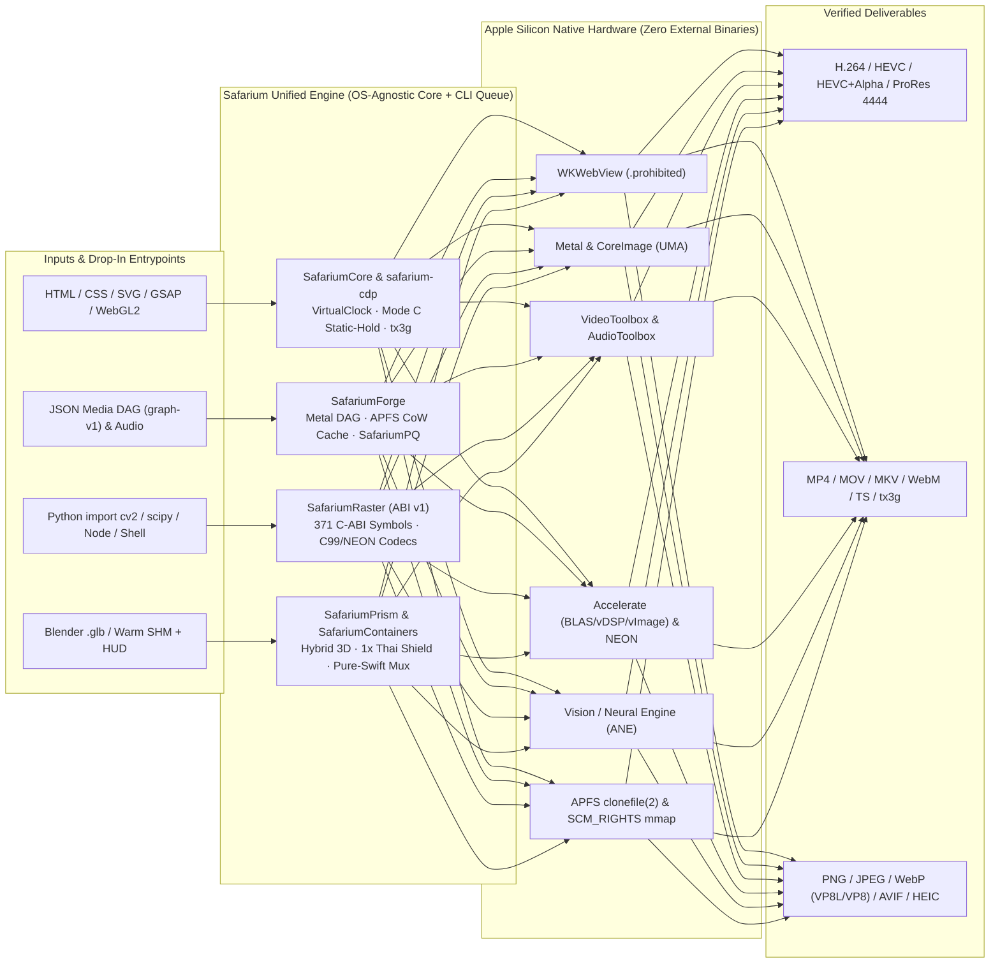

<div align="center">

# Safarium

**Native Apple Silicon HTML, 3D, 2D Raster, and Media Rendering Engine — with an OS-agnostic Core ready for Windows.**

[](https://github.com/sanookai/Safarium/actions/workflows/ci-macos.yml)
[](LICENSE)
[](#quick-start)
[](#verified-cloud-ci)
[](#why-safarium)
[](#3-image-processing-2d-raster--still-codecs)

<p>
  <a href="#why-safarium">Why Safarium?</a> •
  <a href="#at-a-glance-comparison">Comparisons</a> •
  <a href="#real-benchmarks-apple-m5">Benchmarks</a> •
  <a href="#honest-trade-offs--when-not-to-use-safarium">Honest Trade-Offs</a> •
  <a href="#architecture">Architecture</a> •
  <a href="#quick-start">Quick Start</a> •
  <a href="#documentation--research">Docs</a>
</p>

</div>

---

## Why Safarium?

Modern programmatic video, image, and AI-media pipelines typically glue together **Headless Chrome + FFmpeg + OpenCV + Blender**. On a laptop, that stack regularly burns **1.5–4+ GiB of RAM per job**, copies uncompressed frames across processes and disk, ships hundreds of megabytes of third-party binaries, and steals desktop focus or throttles your Mac.

**Safarium** replaces that entire toolchain with one unified, native Apple Silicon engine built strictly on **pre-installed macOS system frameworks** (`WKWebView`, `Metal`, `VideoToolbox`, `AudioToolbox`, `Accelerate`, `Vision`/ANE, and `APFS`):

- **0% FFmpeg / ffprobe / libav**, **0% Chrome / Chromium / Playwright**, and **0% OpenCV** in production binaries (verified by `otool -L` against `/System/Library/*` and `/usr/lib/*` only).
- **81%–94% lower Peak RAM** than Chrome-based HTML video renderers and **3×–4× faster** end-to-end delivery.
- **Windowless & zero focus steal** (`NSApplication .prohibited`) with deterministic JavaScript time (`VirtualClock`).
- **One unified stack** covering HTML/CSS/SVG/WebGL2 video, Metal filter DAGs, hardware encoding, pure-Swift containers, a `371`-symbol `import cv2`-compatible 2D raster engine, and hybrid 3D (Blender + WebGL2 + crisp HTML HUD).
- **Strict quality gates & transparent engineering**: every claim below is backed by reproducible Apple Silicon benchmarks, including **exact areas where competitors still win**.

---

## At-a-Glance Comparison

How Safarium compares across the entire video, web-to-video, computer-vision, and 3D rendering ecosystem:

| Tool / Stack | HTML / WebGL to Video | Video / Audio Pipeline | 2D Raster / CV (`cv2`) | 3D Hybrid + HUD | External Binaries Needed | Typical Peak RAM (1080p) | Platforms Today | Best For |
|---|:---:|:---:|:---:|:---:|---|---:|---|---|
| **Safarium** | ✅ Native `WKWebView` | ✅ `Metal` + `VideoToolbox` | ✅ `371` C-ABI ops + GPU | ✅ `Prism` (WebGL2 + Warm Blender) | **None** (`0%` FFmpeg / Chrome / OpenCV) | **100–302 MiB** | macOS 14+ *(Windows blueprint ready)* | Fast, low-RAM all-in-one HTML/3D/Media/CV pipelines on Apple Silicon |
| **FFmpeg (`libav*`)** | ❌ None | ✅ Universal gold standard | 🟡 Basic filters only | ❌ None | `ffmpeg` + codec libs (GPL/LGPL) | 307–1,438 MiB | Linux / macOS / Windows | Maximum codec breadth (AV1, VP9, MP3, legacy formats) & archival encodes |
| **Remotion** | ✅ React + Chromium | 🟡 Calls FFmpeg | ❌ None | 🟡 Via Three.js in Chrome | Chromium + Node + FFmpeg | 1,605–1,975+ MiB | Linux / macOS / Windows | React component teams prioritizing cloud Linux farm scaling |
| **HyperFrames** | ✅ HTML/GSAP + Chrome | 🟡 Calls FFmpeg | ❌ None | 🟡 Via WebGL in Chrome | `chrome-headless-shell` + FFmpeg | 994–1,762 MiB | Linux / macOS / Windows | AI-generated HTML/GSAP timelines *(can run **without Chrome** via `safarium-hf`)* |
| **Playwright / Puppeteer** | 🟡 Screenshots/CDP | ❌ Needs FFmpeg | ❌ None | ❌ None | Chromium + Node/Python | 350–1,800 MiB | Linux / macOS / Windows | Interactive web scraping & E2E browser testing (not built for fast video) |
| **Motion Canvas / Revideo** | ✅ TS Canvas 2D | 🟡 Calls FFmpeg | ❌ None | ❌ None | Browser/Chromium + FFmpeg | 400–900 MiB | Linux / macOS / Windows | Procedural TypeScript vector/diagram animations |
| **OpenCV (`cv2`)** | ❌ None | 🟡 Bundles FFmpeg | ✅ Industry standard | ❌ None | `opencv` wheel (~100 MB, bundles FFmpeg) | 20–250 MiB | Linux / macOS / Windows | Heavy multi-core CPU computer vision & legacy ecosystem compatibility |
| **`libvips` / `sharp`** | ❌ None | ❌ Stills only | ✅ Streaming image ops | ❌ None | `libvips` + codec libs | 20–90 MiB | Linux / macOS / Windows | High-throughput server-side still image thumbnails & resizing |
| **Cold Blender CLI** | ❌ None | 🟡 Basic VSE | ❌ None | ✅ Cinema PBR / Cycles | Blender (+ FFmpeg/Chrome for HUD) | 1,721–4,000+ MiB | Linux / macOS / Windows | Offline path-traced 3D cinema renders |

> **Legend:** ✅ First-class built-in · 🟡 Partial or delegates to external tools · ❌ Not supported

---

## Detailed Comparisons by Category

### 1. HTML & Web-to-Video Renderers

*Safarium vs. Remotion, HyperFrames (Chrome), Playwright/Puppeteer, Motion Canvas/Revideo, Manim, Skia/Vello/Rive*

| Competitor | How It Works | Where Safarium Wins | Where the Competitor Wins |
|---|---|---|---|
| **Remotion** | Multi-tab Headless Chromium + React + PNG pipe to FFmpeg | **93–94% less Peak RAM** (`116–128 MiB` vs `1,605–1,975 MiB`), **1.7×–1.8× faster** than 4-worker Remotion using only 1 slot, zero Chrome/FFmpeg install, zero focus steal | Cross-platform (Linux cloud Lambda/Docker farms), large React template ecosystem |
| **HyperFrames (Chrome)** | Puppeteer + `chrome-headless-shell` + FFmpeg | **81–88% less Peak RAM** (`116–128 MiB` vs `994–1,762 MiB`), **3.35×–3.87× faster**; `safarium-cdp` even runs HyperFrames directly over `--remote-debugging-pipe` with **zero Chrome** (`SSIM 0.99685`) | Exact Chromium Blink pixel output on Linux servers |
| **Playwright / Puppeteer** | Base64 PNG screenshots over CDP WebSocket | Eliminates Base64/PNG roundtrips via native `WKWebView` + zero-copy `SCM_RIGHTS` mmap ring (`130 MiB` vs `1,558 MiB`) and deterministic `VirtualClock` | General web automation, clicking, form login, and cross-browser QA |
| **Motion Canvas / Revideo** | TypeScript Canvas 2D + headless Chromium + FFmpeg | Supports full **HTML5/CSS Grid/Flexbox/SVG/WebGL2 + native Thai shaping**, plus `7.31×` faster native video decode (`SequentialVideoReader`) without browser frame stalls | Interactive live Vite timeline editor for pure procedural TypeScript vector scenes |
| **Manim (Community / GL)** | Python + Cairo CPU (or deprecated OpenGL) + FFmpeg | No deprecated macOS OpenGL or slow Cairo CPU bottlenecks; GPU-accelerated Metal/WebGL2 + direct `VideoToolbox` encode | Rich LaTeX math animation library & huge Python educator community |
| **Skia / Vello / Rive** | Native/WASM/GPU 2D vector renderers | Full W3C HTML/CSS/SVG/WebGL2 + audio mastering + `tx3g` subtitles + MP4/ProRes delivery out of the box with `0 B` third-party runtime | Ultra-low-level embedded UI/game vector rendering or interactive `.riv` state machines |

---

### 2. Video Pipelines, Encoders & Container Muxers

*Safarium vs. FFmpeg, GStreamer, `x264`/`x265`/`SVT-AV1`/`libaom`/`VVenC`, HandBrake, GPAC/Bento4/MKVToolNix*

| Competitor | How It Works | Where Safarium Wins | Where the Competitor Wins |
|---|---|---|---|
| **FFmpeg (`libav*`)** | C CLI/library with `filter_complex`, `libswscale`, and 100+ codecs | **2.75×–2.90× faster** Metal DAG (`4.08s` vs `11.20–11.82s`), **67%–89% lower host RAM** (`100 MiB` vs `307–933 MiB`), zero GPL/LGPL binary bundling, streaming `O(4096)` audio DSP (no `areverse` OOM), native HTML/3D/ANE in one pass | Universal format/codec support (**AV1, VP9, MP3, Opus encode**, obscure broadcast codecs) and tightest software bitrate control |
| **GStreamer** | Dynamic GLib/GObject plugin graph (`gst-launch-1.0`) | Zero GLib/dylib bundle hell on macOS, deterministic `VirtualClock` HTML + Blender + ANE built in, explicit `E_UNSUPPORTED_CODEC` errors instead of silent CPU `videoconvert` fallbacks | Live streaming servers, RTSP/WebRTC broadcast ingestion, Linux embedded devices |
| **`x264` / `x265` / `SVT-AV1` / `libaom` / `VVenC`** | Multi-threaded CPU software video encoders | **1.96×–11.75× faster** and **3×–10× lower Peak RAM** (`72–143 MiB` vs `356–1,367 MiB`) via Apple Silicon Media Engine ASIC (`VideoToolbox`), keeping Mac cool & responsive | **Wins 8/8 on equal-SSIM compression efficiency (BD-Rate)**: smaller files for archival or ultra-low-bitrate streaming; supports AV1 & H.266 |
| **HandBrake** | GUI/CLI batch transcoder wrapping FFmpeg + `x264`/`x265`/`SVT-AV1` | Programmable JSON DAG, HTML/3D rendering, packet-exact APFS `clonefile` incremental stitching (`3.85×` faster), AI JSONL telemetry (`--progress jsonl`), automated `SafariumPQ` verification | Friendly point-and-click GUI for ripping/transcoding existing video files |
| **GPAC (MP4Box) / Bento4 / MKVToolNix** | Dedicated C/C++ container muxers/demuxers | Pure-Swift `SafariumContainers` handles **MP4/MOV, MKV/WebM, MPEG-TS (33-bit PTS unwrap), MPEG-2 PS, Ogg Vorbis/FLAC, and `tx3g` subtitles** at **`9.9 MiB` RAM**, seamlessly feeding Apple-native `.mp4`/`.mov` + ExFAT `APFSAutoStage` | DASH/HLS CENC DRM encryption (Bento4/GPAC) and exhaustive Matroska spec authoring (MKVToolNix) |

---

### 3. Image Processing, 2D Raster & Still Codecs

*`SafariumRaster` (`libSafariumRaster.dylib`, ABI v1 — **371 C-ABI symbols**, **9,884 parity tests passed, 0 failed**) vs. OpenCV 5.1.0, `libvips`/`sharp`, ImageMagick, `cwebp`/`oxipng`/`mozjpeg`/`avifenc`/`cjxl`*

| Competitor | How It Works | Where Safarium Wins | Where the Competitor Wins |
|---|---|---|---|
| **OpenCV (`cv2` 5.1.0)** | C++ whole-matrix computer vision library (Python wheel bundles FFmpeg) | **0% FFmpeg/OpenCV bloat**, drop-in `import cv2` Python shim covering Core, Linear Algebra (`Accelerate`), ImgProc Filters, Geometry/Contours/Hough/LSD/Subdiv2D, VideoIO, Photo/Inpaint/NLM/HDR/Bayer; **bit-exact C/NEON JPEG decode** (`ΔE00 = 0.0`, `SSIM = 1.0`, `0.907×` faster), **PNG `2.30×` faster & smaller**, **4K Metal GPU `8/9` speed wins (`1.4×–6.3×`)** | Multi-core CPU SIMD throughput on general `ops` (single-threaded `cv2` benchmark currently `47/97` WIN+TIE provisionally under load), plus decades of niche CV/calib3d/ML modules |
| **`libvips` / `sharp`** | Streaming multi-threaded C tile engine (Node N-API addon) | Zero native npm C++ addon rebuilds across Node ABI bumps, plus adds **Metal GPU**, **ANE person matting/reframe**, and **full video timelines** (`libvips`/`sharp` are stills-only) | Ultra-low-RAM multi-core server thumbnailing of gigantic (`10,000×10,000+`) still images on Linux |
| **ImageMagick** | Eager full-canvas rasterizer with 200+ format delegates | **4×–8× faster** contact sheets & transforms without 200 MB delegate trees or `/tmp` pixel-cache RAM explosions (`127 MiB` streaming contact sheets, zero re-decode inline sheets) | Niche legacy print/vector formats (EPS, PSD, CMYK PDF, 200+ formats) |
| **`cwebp` / `oxipng` / `mozjpeg` / `avifenc` / `cjxl`** | Specialized standalone still-image encoders | Pure-Swift/C99 **PNG & WebP `VP8L`/`VP8`** written from scratch (`WebP VP8L` **`1.43×–2.28×` faster than `cwebp`** with strict 14-bit `<= 16383` guard; solves Apple `ImageIO`'s missing WebP write support) + zero-dep Apple `ImageIO` HEIC/HEICS/AVIF | Deep offline lossy/lossless size density (`avifenc`, `cjxl`, `mozjpeg` trellis, `zopflipng` brute-force) when file size beats speed |

---

### 4. 3D / VFX Hybrid & Incremental Pipelines

*`SafariumPrism` + `ForgeIncrementalCache` vs. Cold Blender CLI + Chrome + FFmpeg, VapourSynth, MLT*

| Competitor | How It Works | Where Safarium Wins | Where the Competitor Wins |
|---|---|---|---|
| **Cold Blender CLI + Chrome + FFmpeg** | Spawns cold `blender -b` to PNGs on disk, then Chrome + FFmpeg to composite HUD | **Tier-0 `webkitGLB` multi-angle previews: `3.12×–4.68×` faster at `25 MiB` vs `1,721 MiB` (`-98.5%` RAM)**; Warm Blender SHM worker eliminates cold startups; **`0 B` intermediate PNG disk churn** (vs `61` PNGs / `24.8 MB`); **`1× Thai Shield`** protects typography from MetalFX distortion; **`HEVCWithAlpha` `42.85×` smaller** than ProRes 4444 | Maximum offline Cycles path-traced render farms on multi-GPU Linux/Windows nodes |
| **VapourSynth / AviSynth+** | Scripted CPU frame server piping raw video to FFmpeg/`x264` | Native Apple Silicon ARM64 (`Metal + Accelerate + ANE`) without fragmented macOS `.dylib`/Windows `.dll` plugins or `vspipe` roundtrips | Deep archival video restoration plugins (`QTGMC`, `BM3D`, `znedi3`) on x86 Windows/Linux |
| **MLT / `melt`** | C NLE timeline engine (Shotcut / Kdenlive) over FFmpeg + OpenGL | Native **Metal TBDR** (`3.87 ms/frame`), no deprecated macOS OpenGL (`Movit`), native `WKWebView` `VirtualClock` HTML overlays, and **APFS `clonefile(2)` Closed-GOP cache (`3.854×` faster, `0/150` diff frames)** | Desktop GUI NLE integrations (Shotcut / Kdenlive project `.mlt` ecosystem) |

---

## Real Benchmarks (Apple M5)

All measurements below were collected on Apple Silicon (macOS, Apple M5) using `proc_pid_rusage` (`ri_phys_footprint` / `libproc` process tree RAM) and verified perceptual/media gates (`SSIM >= 0.97`, `PSNR >= 30 dB`, `ΔE00 p95 <= 2.0`, zero-FFmpeg `safarium verify`). Full datasets live in [docs/research-2026-11-24/experiment-results.md](docs/research-2026-11-24/experiment-results.md).

### HTML-to-Video (`H1`: 1080×1920, 30 fps, 5s)

| Engine | Wall Time | Peak Tree RAM | Speedup vs Chrome HF | RAM Saved | `safarium verify` |
|---|---:|---:|---:|---:|:---:|
| **Safarium (`safarium-html`)** | **2.78–3.31 s** | **116–128 MiB** | **3.35×–3.87× faster** | **-81% to -88%** | ✅ Pass (`0`) |
| HyperFrames (Chrome) | 10.67–11.11 s | 994–1,762 MiB | 1.00× (baseline) | — | ✅ Pass (`0`) |
| Remotion (`concurrency=4`) | 5.11–5.59 s | 1,605–1,975 MiB | 1.99×–2.09× | **+61% more RAM** | ❌ Failed (`1`) |

> *Honest note:* Subpixel anti-aliasing differences between WebKit and Chromium Skia produced `ΔE00 p95 = 2.002–2.288` on raw cross-engine `safarium-html` vs Chrome (`safarium-cdp` passed at `1.464–1.702`). Wave 8 added `ColorCalibrationTests` and colorimetry calibration to tighten alignment.

### Media Filter DAG + Audio Loudnorm (`H2`: 1080×1920, 10s — LUT + Blur + Overlays + BS.1770-4)

| Engine | Wall Time | Host Peak RAM | Combined Tree RAM | Quality (`MS-SSIM` / `ΔE00 p95` / LUFS err) | Output Size (`8M` target) |
|---|---:|---:|---:|---|---:|
| **Safarium (`safarium-forge`)** | **4.08 s** | **100 MiB** | **302 MiB** | `0.9967` / `1.65–1.85` / `0.0002 LU` | 1.77×–2.31× larger *(honest VT trade-off)* |
| FFmpeg (`h264_videotoolbox`) | 11.82 s | 307 MiB | 356 MiB | Reference | 1.00× |
| FFmpeg (`libx264`) | 11.20 s | 933 MiB | 933 MiB | Reference | 0.77× |

### Hardware vs. Software Encoders Pareto (`H3`), Incremental Cache (`H5`), & 3D Hybrid (`H6`)

| Experiment | Metric | Safarium Result | Baseline / Rival | Delta |
|---|---|---:|---:|---|
| **`H3` VideoToolbox vs `x264`/`x265`/`SVT-AV1`** | Peak RAM & Encode Speed | **72–143 MiB**, **1.30–1.45 s** | 356–1,367 MiB, 2.5–17.0 s | **14/14 wins** on RAM & Speed (`1.96×–11.75×` faster); **0/8** on BD-Rate *(SW wins equal-SSIM bytes)* |
| **`H4` Still Codecs (`SafariumRaster`)** | JPEG decode / PNG / WebP VP8L | Bit-exact JPEG (`ΔE00 = 0.0`, `SSIM = 1.0`) | OpenCV 5.1.0 & `cwebp` | JPEG **`0.907×`** WIN; PNG **`2.30×`** faster & smaller; WebP VP8L **`1.43×–2.28×`** faster than `cwebp` |
| **`H5` APFS `clonefile` Closed-GOP Cache** | Partial-edit re-render (`150f`) | **2.89 s** (`0/150` diff frames) | 11.13 s full re-render | **`3.854×` faster**, bit-exact packet reuse (`150/150` SHA-256 identical) |
| **`H6` `SafariumPrism` Tier-0 `webkitGLB`** | Multi-angle 3D preview stills | **25 MiB** RAM, **0 B** temp PNGs | Cold Blender **1,721 MiB**, **24.8 MB** PNGs | **`3.12×–4.68×` faster**, **`-98.5%` RAM**, `HEVCWithAlpha` **`42.85×` smaller** than ProRes 4444 |

---

## Honest Trade-Offs — When NOT to Use Safarium

We prefer transparent engineering over hype. You should **not** choose Safarium as your primary tool if:

1. **You need Linux or Windows production execution right now.** Safarium runs on **macOS 14+ (Apple Silicon)** today. Its core IR, containers, and platform traits are already OS-agnostic, and the [Windows Blueprint](docs/research-2026-11-24/cross-platform-core-windows-blueprint.md) (`Edge WebView2 + Direct3D 12 + Media Foundation`) is designed, but not yet implemented.
2. **You need the smallest possible archival video file size (BD-Rate) or AV1/VP9/MP3 encoding.** Apple's `VideoToolbox` prioritizes real-time speed and low RAM over exhaustive multi-pass RDO. Software `x264 --preset veryslow`, `x265`, and `SVT-AV1` beat `VideoToolbox` (`8/8`) on equal-SSIM bitrate efficiency, and Apple Silicon has no hardware encoder for `AV1`, `VP9`, or `MP3`.
3. **You run heavy multi-core CPU OpenCV pipelines.** `SafariumRaster` passes **9,884** reference parity tests and beats OpenCV on Metal 4K GPU (`8/9`) and custom still codecs, but its single-threaded CPU `ops` path currently trails OpenCV 5.1.0 on several kernels (`47/97` = `48.5%` WIN+TIE provisionally under high host load: `numpy 65.2%`, `codec 60.0%`, `draw 58.8%`, `ops 31.0%`).
4. **You need deep offline still compression (`cjxl`, `avifenc`, `mozjpeg`, `zopflipng`).** Safarium optimizes for fast, zero-dependency, universally playable PNG/JPEG/WebP/HEIC/AVIF rather than slow brute-force compression.
5. **You keep full Blender + WebGL2 resident at the exact same instant.** Concurrent hybrid rendering (`H6B`) peaks higher combined RAM (`2,038 MiB` vs `1,721 MiB`) than running a single engine alone unless using Tier-0 `webkitGLB` previews.

---

## Architecture



### Core Components

| Module | Location | What It Does |
|---|---|---|
| **`SafariumCore`** | `Sources/SafariumCore/` | Windowless `WKWebView` engine, `VirtualClock` (`clock.js`), Mode C static-hold probe, `AVAssetWriterSink` (H.264, HEVC, HEVC-with-alpha, ProRes 422/4444), `SequentialVideoReader`, `LosslessSoundtrackMux`, `OfflinePeakLimiter`, `SafariumTX3G`, and `SafariumPlatformBackend` |
| **`SafariumForgeCore` + `safarium-forge`** | `Sources/SafariumForgeCore/`, `Sources/safarium-forge/` | Declarative JSON DAG media engine, Metal filter shaders, `AF_UNIX` + `SCM_RIGHTS` unlinked `mmap` ring encoder, APFS `clonefile(2)` incremental cache, `APFSAutoStage` (ExFAT-safe), `SafariumPQ` (MS-SSIM, CIEDE2000, Vision OCR), and AI JSONL control plane (`--progress jsonl`, `--json-errors`) |
| **`SafariumPrism`** | `Sources/SafariumPrism/`, `Tools/prism-blender-worker.py` | Hybrid 3D engine uniting Warm Blender SHM (`EEVEE`/`CYCLES`) + WebKit WebGL2/Three.js + `1× Thai Shield` HUD overlay, MetalFX/LLSR upscaling with `SafariumPQ` fallback, and HID/thermal Anti-Lag Governor |
| **`SafariumRaster` + `SafariumRasterC`** | `Sources/SafariumRaster/`, `Sources/SafariumRasterC/` | Dynamic C-ABI library (`libSafariumRaster.dylib`, **`371` symbols**): Core, `Accelerate` Linear Algebra, ImgProc Filters, Geometry/Contours/Hough/LSD/Segmentation/Subdiv2D, VideoIO, Photo/Inpaint/NLM/SeamlessClone/NPR/HDR/Bayer, opt-in Metal GPU, and custom C99/NEON still codecs (PNG, JPEG, WebP VP8/VP8L, TIFF, GIF) |
| **`SafariumContainers`** | `Sources/SafariumContainers/` | Pure-Swift bitstream muxers/demuxers: EBML/MKV/WebM, MPEG-TS (33-bit PTS unwrapping), MPEG-2 PS, Ogg/Vorbis I + FLAC, WebP RIFF/VP8L |
| **`safarium-cdp` & `bin/safarium-hf`** | `Sources/safarium-cdp/`, `bin/safarium-hf` | Chrome DevTools Protocol pipe shim driving `WKWebView` so Puppeteer and HyperFrames run with **zero Chrome** |
| **Unified CLI & Drop-In SDKs** | `bin/safarium`, `bin/safarium-render`, `sdk/` | Single-slot FIFO render queue (`SF-VIDEO-1`), zero-dep Python/Node/Shell SDKs, plus drop-in `sdk/python/safarium_cv2` (`import cv2`) and `sdk/python/safarium_sci` |

---

## Quick Start

**Requirements:** macOS 14+ (Apple Silicon), Xcode 16+ / Swift 6.1+.

> **Tip:** Always pass `--scratch-path` on an APFS volume (e.g., `/tmp/safarium-build`) when building from an external ExFAT disk.

```sh
# 1. Build Release binaries & libSafariumRaster.dylib
xcrun swift build -c release --jobs 2 --scratch-path /tmp/safarium-build \
  --product safarium-html --product safarium-media --product safarium-forge \
  --product safarium-cdp --product SafariumRaster

# 2. Build standalone zero-FFmpeg media verifier
xcrun swiftc -parse-as-library -O Tools/safarium-verify.swift -o /tmp/safarium-build/safarium-verify

# 3. Install into ~/.local (verifies Apple-only otool -L & SHA-256 manifest)
RELEASE="$(xcrun swift build -c release --scratch-path /tmp/safarium-build --show-bin-path)"
python3 Tools/install-render.py --release "$RELEASE" --verifier /tmp/safarium-build/safarium-verify
python3 Tools/install-render.py --check

# 4. Verify environment, capabilities, and 371-symbol C ABI
"$HOME/.local/bin/safarium" doctor --json
"$HOME/.local/bin/safarium" capabilities
"$HOME/.local/bin/safarium" raster info
```

### Everyday Examples

```sh
# 1. Deterministic windowless HTML/CSS/SVG/WebGL2 -> MP4
safarium html scene.html --output out.mp4 --width 1080 --height 1920 --fps 30 --frames 90 --video-only

# 2. Run a declarative Metal/Audio/Overlay DAG with AI-friendly JSONL telemetry
safarium forge run --recipe graph.json --progress jsonl --json-errors

# 3. Verify decoded video, audio, and tx3g subtitle timing (zero FFmpeg)
safarium verify reference.mp4 out.mp4

# 4. Run HyperFrames timelines without installing Chrome
safarium-hf render project/ --output out.mp4

# 5. Drop-in Python cv2 backed by libSafariumRaster.dylib (zero OpenCV / FFmpeg)
PYTHONPATH=sdk/python/safarium_cv2 \
  python3 -c 'import cv2; print(cv2.__version__, hasattr(cv2, "inpaint"), hasattr(cv2, "findContours"))'
```

---

## Verified Cloud CI

Every push is verified by 2-Tier GitHub Actions macOS Cloud CI ([`.github/workflows/ci-macos.yml`](.github/workflows/ci-macos.yml)) across **two macOS & Swift generations** — latest run **4/4 GREEN**:

| Check | `macos-15` (Xcode 16.4 / Swift 6.1.2) | `macos-26` (Xcode 26.6 / Swift 6.3.3) |
|---|---|---|
| **Public Repo Hygiene Audit** (`0` personal paths / secrets / forbidden calls) | ✅ `0` violations | ✅ `0` violations |
| **Apple-Only `otool -L` Linkage** (`0%` FFmpeg / Chrome / OpenCV) | ✅ `6/6` Apple-only | ✅ `6/6` Apple-only |
| **C99 Codec ASan/UBSan + Swift XCTest Suite** | ✅ `234` executed, `0` failed | ✅ `234` executed, `0` failed |
| **Queue & Installer Tests (`test_queue.py`)** | ✅ `23/23` OK | ✅ `23/23` OK |
| **`SafariumRaster` Reference Parity Suite** | ✅ **`9,884` passed, `0` failed** | ✅ **`9,884` passed, `0` failed** |
| **Cross-OS H.264 Smoke Determinism** | ✅ Identical SHA-256 across both OSes | ✅ Identical SHA-256 across both OSes |

---

## Cross-Platform Roadmap (Windows)

Safarium's OS-agnostic Core (`ForgeRecipe` IR, `PrismSceneIR`, `VirtualClock` JS, pure-Swift containers, ring IPC, AI JSON control plane, and C99 codecs) isolates platform primitives behind `SafariumPlatformBackend`. Planned `WindowsBackend`:

- **Web Frame Renderer:** Microsoft Edge `WebView2` Evergreen (`ICoreWebView2CompositionController`) + `Windows.Graphics.Capture`
- **GPU Compositor & Filters:** Direct3D 12 (`ID3D12Device`) + HLSL Compute + Direct2D
- **Hardware Video / Audio:** Media Foundation (`IMFSinkWriter` + `IMFDXGIDeviceManager` -> NVENC / QSV / AMF, including hardware AV1) + WASAPI / C99 DSP
- **CoW Cache & IPC:** ReFS (`FSCTL_DUPLICATE_EXTENTS_TO_FILE`) + Named Pipes + Win32 Job Objects

---

## Documentation & Research

- **[World Video, Web-to-Video, Image & Hardware Ecosystem Matrix (47 Tools)](docs/research-2026-11-24/world-video-ecosystem-matrix.md)** — Deep technical comparison across all 4 categories
- **[Empirical Benchmark Results (`H1–H7`)](docs/research-2026-11-24/experiment-results.md)** — Full measurements, methodology, wins, and losses
- **[Cloud CI Results (`macos-15` & `macos-26`)](docs/research-2026-11-24/cloud-ci-results.md)** — Reproducible dual-OS CI verification report
- **[Cross-Platform Core & Windows Blueprint](docs/research-2026-11-24/cross-platform-core-windows-blueprint.md)** — `SafariumPlatformBackend` architecture & Windows mapping
- **[SafariumForge Guide](docs/safarium-forge-guide-2026-11-23.md)** — Declarative JSON DAG recipes, Metal filters, and audio mastering
- **[SafariumRaster Roadmap](docs/raster-roadmap.md)** — `371`-symbol C-ABI architecture & OpenCV parity coverage
- **[AI Control Protocol](docs/ai-control-protocol.md)** — Machine-readable `--progress jsonl`, `--json-errors`, and `E_*` taxonomy
- **[Chrome-less CDP Shim (`safarium-cdp`)](docs/cdp-shim.md)** — Running Puppeteer & HyperFrames on `WKWebView`

---

## License

Licensed under the **Apache License, Version 2.0**. See [LICENSE](LICENSE) for the full text.
