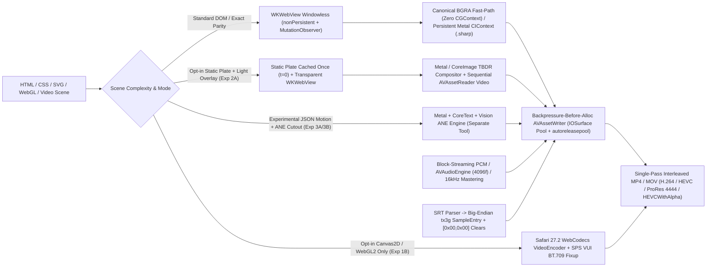

# Safarium Apple Silicon Innovation & Zero-FFmpeg / Zero-Chrome Blueprint (2026-11-22)

> **สรุปกรอบงาน & หลักฐาน:** เอกสารนี้รวบรวมผลวิจัย 13 ชิ้น + การสร้างและทดสอบต้นแบบ 3 สายใน scratch (`/tmp/safarium-innovations-20261122/`) + การตรวจซ้ำอิสระทุกไบนารี/ผลลัพธ์โดย `harness-verifier` บนเครื่องจริง **Apple M5 · 16 GiB RAM · macOS 27.2 (`26B123`) · Swift 6.4.2** ภายใต้มาตรฐาน **SF-VIDEO-1** (`SSIM ≥ 0.97`, `PSNR ≥ 30 dB`, `ΔE00 p95 ≤ 2.0`) · **สำเนาถาวรของซอร์สและ JSON ผลวัดทั้งหมดเก็บไว้ใน `Projects/Safarium/bench/experiments/2026-11-22-apple-silicon/` · ยังไม่แก้ซอร์สผลิตใน `Sources/` และไม่แก้สคริปต์ตอนจริงของปิ๊ก**
>
> **ผลตรวจการปฏิบัติตามกฎ (`compliance_audit`):** `otool -L` ทุกไบนารี (`harness` 1 ตัว, `track1` 4 ตัว, `track2` 1 ตัว, `track3` 1 ตัว) พบ **0 FFmpeg / ffprobe / libav / Chrome / Chromium / Safari.app** (`non_apple_libs: []`, `zero_forbidden_runtime_deps_pass: true`) · คิวจบงาน `safarium-render status` ว่างปกติ (`idle`) · ไม่พบการเปลี่ยนหน้าต่างโฟกัสจอ (`lsappinfo front` คงเดิม)

---

## 1. สรุปผู้บริหาร & ตารางตัดสินใจ (Adoption Matrix)

วัด RAM ด้วย `libproc` `proc_pid_rusage(RUSAGE_INFO_V6)` `ri_phys_footprint` ทุก 50 ms (`measure_footprint.py`) รายงานทั้ง `group_peak_mib` (รวม wrapper/guardian ของ `safarium-render` ~18 MiB) และ `renderer_group_peak_mib` (เฉพาะโปรเซสเรนเดอร์ + XPC ลูก)

### 1.1 Tier 1 — Gate 1 PASS (พร้อมนำเข้า `Sources/` เป็น drop-in: ภาพ/เวลาตรงทุกบิต `exactMatch=true` + ประหยัด RAM/ดิสก์/เสถียร)

| นวัตกรรม (Track / Exp) | ผลวัดหลักฐานจริง (ค่ามัธยฐาน + ตรวจซ้ำอิสระ) | การตรวจยืนยัน (`verify` / `native_quality` / OCR) |
|---|---|---|
| **Persistent Metal `CIContext` + Render ตรงลง `CVPixelBuffer` (โหมด `.sharp`)** (`Exp 1A-4`) | Group RAM **3,967.77 → 310.24 MiB (-92.18%)** · ตรวจซ้ำ **4,006.13 → 289.03 MiB (-92.79%)** · Host **3,880.58 → 223.16 MiB (-94.2%)** · ความเร็ว **2.28×** (3,208.05 → 1,407.89 ms; ตรวจซ้ำ 3.104 → 1.363 s) | `safarium-render verify` `exactMatch=true` (ทั้งรอบ Track 1 และตรวจซ้ำ) · `SSIM=1.0`, `PSNR=Inf`, `ΔE00 p95=0`, Thai OCR เป๊ะ 6/6 บรรทัด |
| **Single-Pass Interleaved Video+PCM `AVAssetWriter` + `tx3g` Subtitles** (`Exp 1C`) | ดิสก์ชั่วคราว **1,859,158 → 941,587 B (-49.35%)** (เขียนรอบเดียว เลิกเขียน `picture.mp4` + `AVAssetReader` demux) · เวลา ~2.81 s และ RAM ~403 MiB เทียบเท่า 2-pass · ซับไตเติล `'sbtl'`/`'tx3g'` (`pol`/`pl`) ทำงานจริง | `verify` 1-pass vs 2-pass `exactMatch=true`; ตรวจซ้ำตรงทั้ง 2-pass และ `ep30-24-26-native.mp4` (`diff=[]`) · `tx3g`: `playable=true`, 2 cues ภาษาโปแลนด์+ไทยครบ, 3 empty `[0x00,0x00]` clears, 0 malformed |
| **Canonical BGRA Fast-Path + Backpressure-Before-Alloc + Non-Persistent DataStore + `autoreleasepool`/`memflush`** (`Exp 2B`) | 300 เฟรม: ความเร็วคงที่ ~8.62–8.69 ms/f (`~115–116 fps`), Group RAM รวมคงที่ ~162 MiB บน DOM เบา แต่ **ความชัน RAM ครึ่งหลังคลิปพลิกจาก `+0.934` เป็น `-0.357` (streaming) และ `-1.232 MiB/s` (`memflush_60`)** · fast-path ตัด `CGContext` 300/300 เฟรม (`-27.3%` append ms ใน Track 2) | `safarium-render verify` 300/300 เฟรม `exactMatch=true` ทุกคู่ + ตรวจซ้ำ (`SSIM=1.0`, `ΔE00 p95=0`) · ผ่าน TDD `MutationObserver` **9/9** |
| **`IOSurface` + Metal-Compatible `CVPixelBufferPool` (BGRA)** (`Exp 1A-1`) | Group RAM **193.75 → 187.83 MiB (-3.1%)**, Host **107.06 → 100.86 MiB**, เวลาภายใน **487.80 → 478.11 ms** on pre-cached CGContext | `safarium-render verify` `exactMatch=true` · `SSIM=1.0`, `PSNR=Inf`, `ΔE00 p95=0` |

### 1.2 Tier 2 — Gate 2 PASS (ก้าวกระโดดด้านความเร็วหรือปิดช่องว่าง Zero-FFmpeg; ผ่าน SF-VIDEO-1 แบบ opt-in / ความสามารถใหม่)

| นวัตกรรม (Track / Exp) | ผลวัดหลักฐานจริง (ค่ามัธยฐาน + ตรวจซ้ำอิสระ) | ข้อจำกัด / เงื่อนไขการใช้งาน |
|---|---|---|
| **Layer-Split Hybrid GPU (`hybrid_gpu_snapshot`)** (`Exp 2A`) | ฉาก SVG/การ์ดหนัก: **58.152 → 8.170 ms/f (7.12× engine / 3.43× wall)** (`3.805s → 1.108s`; ตรวจซ้ำ `3.963s → 1.159s`) · Group RAM มัธยฐาน **400.99 → 304.57 MiB (-24.0%)** *(หมายเหตุ: รอบตรวจซ้ำเดี่ยววัดได้ `398.54 → 394.79 MiB` จาก `WebContent` spike ชั่วคราว 90.4 MiB)* | `SSIM=0.99252`, `PSNR=45.74 dB`, `ΔE00 p95=1.4831`, Thai OCR 5/5 บรรทัดเป๊ะ · **ต้อง opt-in** เฉพาะฉากที่แยก static plate + overlay ที่ตรวจด้วย `MutationObserver` ได้ |
| **Sequential `AVAssetReader` → Metal `CIImage` Video Background** (`Exp 2A`) | แทน JS Base64 PNG bridge: **60.266 → 8.240 ms/f (7.31× engine / 4.81× wall)** (`4.108s → 0.855s`; ตรวจซ้ำ `4.180s → 0.863s`) · RAM ใกล้เคียงเดิม (`321.93 → 333.38 MiB`; ตรวจซ้ำ `338.38 → 333.85 MiB`) | `SSIM=0.99874`, `PSNR=45.68 dB`, `ΔE00 p95=1.7331`, `colorimetryTagsMatch=true` |
| **Native Zero-FFmpeg Media Suite: 16k WAV + ImageIO GIF + `AVAudioEngine` Block Mixer** (`Exp 1C Suite`) | รันชุดรวม 0.513 s, Host `61.81 MiB` (`79.85 MiB` group): (1) 16 kHz mono WAV (`Mastering` + `.normal`) **0-sample impulse delay** (`peak @ 8000`) + ถอด EP30 ได้ **32,000 samples @ 16 kHz** จริง; (2) ImageIO GIF 30f `loop=0` delay error ≤ `0.0033s`; (3) `AVAudioEngine` block 4096f ชดเชย `PeakLimiter` 96f ได้ 96,000 frames พอดี `peak=0.8728`, sync lag `0` (`r=0.8681`) | ใช้ทดแทนคำสั่ง `ffmpeg` ด้านเสียง 16kHz (Wispr), GIF และ offline mix/normalize ได้ทันที |
| **Safari 27.2 WebCodecs (`webcodecs_avc_fixed`)** (`Exp 1B`) | สำหรับฉาก Canvas2D + WebGL2 ล้วน: encode ภายใน **546.25 → 316.16 ms (1.73×)**, wall **1,108.09 → 857.07 ms**, `SSIM=0.99827`, `PSNR=48.68 dB`, `ΔE00 p95=1.3220`, Thai OCR 4/4 บรรทัดเป๊ะ | **มีเงื่อนไขชัด:** Group RAM **เพิ่ม +7.5%** (`334.15 → 359.22 MiB`; ตรวจซ้ำ `337.19 → 356.46 MiB`), raw WebCodecs ให้ `fullRange=true` + `iec61966-2-1` จนกว่าจะแก้ SPS VUI, HEVC ช้า (`23.3 fps`, `414.4 MiB`), **ส่ง HTML/CSS DOM เข้า `VideoFrame` ไม่ได้** |
| **M5 `HEVCWithAlpha` (`muxa`) + `vImage`/`vDSP` + `Vision` ANE Cutout** (`Exp 3B`) | `HEVCWithAlpha` (`PremultipliedAlpha`) ผ่าน round-trip `0/128/253` ที่ **9.948 ms/f**, ไฟล์ **190.8 KB** (**เล็กกว่า ProRes 4444 `8.18 MB` ถึง 42.85×**) · `vImage` blend **13.46×** (`0.240 vs 3.224 ms`, diff `0`), `vImage` BGRA→420 **21.15×** (`0.130 vs 2.745 ms`), `vDSP` biquad+RMS **1.64×** · `Vision` ANE mask **14.36 ms/f** (`80.36 MiB` neural footprint, 2 instances, 15.69% fg) | เก็บ `ProRes 4444` (`3.75 ms/f`, `StraightAlpha`) เป็น default หลัก จนกว่าปิ๊กจะเลือกเพิ่ม flag `--codec hevc-alpha` · ส่วน `Vision` ANE เหมาะเป็น capability ใหม่ (เช่น ตัดพื้นหลัง/auto-mask) |

### 1.3 Tier 3 — Gate 3 FAIL / ไม่แนะนำนำเข้า `Sources/` (หลักฐานตรงไปตรงมา)

| รายการที่คัดออก / ไม่ผ่าน | ค่าที่วัดได้จริง | สาเหตุที่ตัดออกจาก `Sources/` |
|---|---|---|
| **`A2_nv12_metal` (Metal shader BGRA→NV12)** (`Exp 1A-2`) | `ΔE00 p95 = 2.7448 > 2.0`, Group RAM **199.00 vs 193.35 MiB** (สูงกว่า baseline) | ไม่ผ่านเกณฑ์สี SF-VIDEO-1 และเปลือง RAM เพิ่ม |
| **`A2_nv12_vimage` (`vImageConvert_ARGB8888To420Yp8_CbCr8`)** (`Exp 1A-2`) | Group RAM **-23.4%** (`193.35 → 148.03 MiB`), `ΔE00 p95 = 1.8861` | **ติดเงื่อนไข chroma siting:** `vImage` เขียน `Center` แต่ VideoToolbox H.264 คาดหวัง `Left` → `colorimetryTagsMatch=false` และ `verify exactMatch=false` (รอเขียน chroma filter Left-sited หรือปิดเฉพาะ opt-in ไม่ใช่ drop-in) |
| **`mac-engine` Native JSON Engine (`bgra32` & `nv12`)** (`Exp 3A`) | เร็วขึ้น **7.60× wall** (`5.4556 → 0.7182 s`; ตรวจซ้ำ `7.76×`), `SSIM=0.9848`, `PSNR=36.27 dB`, Thai OCR ครบ 6 บรรทัด **แต่ `ΔE00 p95 = 2.2027` (BGRA) และ `2.3216` (NV12) > `2.0`** · **RAM สูงกว่า WebKit +67.7% / +39.7%** (`310.50` / `258.60` vs `185.13 MiB`) | ตรวจเชิงพื้นที่เฟรมที่ 60 พบจุดต่างกระจุกอยู่ที่ตัวอักษร CoreText เทียบกับ WebKit (`pct>16`: `2.79%` หัวเรื่อง, `2.70%` คำบรรยาย vs `0.43–0.50%` พื้นหลัง) + ฉาก 120 เฟรมใช้ RAM host+Metal สูงกว่า WebKit → **ยืนยันข้อสรุป `docs/native-engine-decision.md` ว่าไม่แทน HTML engine ทั้งก้อน** (เหมาะเป็น JSON capability พิเศษเฉพาะงาน เช่น `Exp 3A full-features` ที่ `HEVC NV12` วิ่ง `146.3 fps`) |
| **`vImageScale_ARGB8888` Lanczos5 (`Exp 3B`)** | **10.134 ms vs 2.713 ms** (`0.27×` ช้ากว่า scalar 2×2 box) | ห้ามใช้แทนการย่อภาพแบบเร็ว; ให้ใช้ `CIContext` Metal `CILanczosScaleTransform` แทน |

---

## 2. รายละเอียดผลวัดจริงทุกการทดลอง (Verified Benchmark Ledger)

> ข้อมูลทั้งหมดอ้างอิงจาก [verified-benchmarks.json](../bench/experiments/2026-11-22-apple-silicon/verified-benchmarks.json) และรายงานรายสายใน [track1/results.json](../bench/experiments/2026-11-22-apple-silicon/track1/results.json), [track2/results.json](../bench/experiments/2026-11-22-apple-silicon/track2/results.json), [track3/results.json](../bench/experiments/2026-11-22-apple-silicon/track3/results.json) โดยคงตัวเลขจริงจาก both track runs และ independent `harness-verifier` rechecks

### 2.1 Track 1 — Zero-Copy UMA, Backpressure, WebCodecs & Single-Pass Media (`Exp 1A–1C`)

| การทดลอง | Arm | Wall (ms) | Internal (ms) | Group Peak (MiB) | Renderer Group (MiB) | Host Peak (MiB) | `SSIM` / `PSNR` / `ΔE00 p95` | `verify` (`exactMatch`) |
|---|---|---:|---:|---:|---:|---:|---|---|
| **1A-1** (120f) | `baseline` | 660.64 | 487.80 | 193.75 | 175.77 | 107.06 | ref | ref |
| **1A-1** (120f) | `A1_iosurface_bgra` | 658.38 | 478.11 | **187.83** | 169.72 | 100.86 | `1.0` / `Inf` / `0` | **`true`** |
| **1A-2** (120f) | `baseline` | 659.36 | 498.51 | 193.35 | 175.28 | 107.16 | ref (ตรวจซ้ำ `194.05`) | ref |
| **1A-2** (120f) | `A2_nv12_vimage` | 658.62 | 465.14 | **148.03** *(ตรวจซ้ำ `146.05`)* | 129.88 | 60.50 *(58.16)* | `0.99637` / `42.89` / `1.8861` (`tagsMatch=false`) | `false` (`Center!=Left`) |
| **1A-2** (120f) | `A2_nv12_metal` | 658.13 | 468.08 | 199.00 *(ตรวจซ้ำ `199.02`)* | 180.94 | 112.08 | `0.99539` / `42.04` / **`2.7448`** (`FAIL`) | `false` |
| **1A-3** (120f) | `A3_avwriter_noreorder` | 609.30 | 462.36 | 119.91 | 101.80 | 55.02 | ref (vs noreorder) | ref |
| **1A-3** (120f) | `A3_vt_direct` | 610.29 | 454.39 | **109.78** | 91.66 | 36.84 | `0.99943` / `51.10` / `1.0936` *(vs base `1.8899`)* | `false` |
| **1A-4** (4K→1080p) | `sharp_baseline` | 3,208.05 | 2,997.56 | 3,967.77 *(ตรวจซ้ำ `4,006.13`)* | 3,949.63 | 3,880.58 | ref | ref |
| **1A-4** (4K→1080p) | `sharp_persistent_metal` | **1,407.89** *(1,362.5)* | **1,190.03** | **310.24** *(ตรวจซ้ำ `289.03`)* | **292.22** | **223.16** *(202.3)* | `1.0` / `Inf` / `0` | **`true`** |
| **1B** (Canvas/GL 60f) | `takeSnapshot` | 1,108.09 | 546.25 | 334.15 *(ตรวจซ้ำ `337.19`)* | 316.08 | 39.56 | ref | ref |
| **1B** (Canvas/GL 60f) | `webcodecs_avc_fixed` | **857.07** | **316.16** | 359.22 *(ตรวจซ้ำ `356.46`)* | 341.30 | 18.16 | `0.99827` / `48.68` / `1.3220` | `false` (คนละ bitstream) |
| **1B** (probe) | `webcodecs_hevc_fixed` | 3,308.29 | 2,575.03 | 414.38 | — | — | `0.99497` / `41.04` / `1.9870` (`23.3 fps`) | `false` |
| **1C** (EP30 60f) | `two_pass_safarium_html` | 2,812.93 | 2,812.93 | 402.94 *(ตรวจซ้ำ `405.90`)* | 384.86 | 39.41 | ref (`temp_disk: 1,859,158 B`) | ref |
| **1C** (EP30 60f) | `single_pass_interleaved` | 2,812.92 | 2,812.92 | 403.66 *(ตรวจซ้ำ `417.99`)* | 385.58 | 56.75 | `1.0` / `Inf` / `0` (`temp_disk: 941,587 B`) | **`true`** *(ตรวจซ้ำตรงทั้ง 2-pass & stage)* |
| **1C** (`tx3g` `pol`) | `ep30_1pass_pol_tha_subtitles` | 2,858.96 *(ตรวจซ้ำ)* | — | 405.63 | 387.63 | 56.30 | `1.0` / `Inf` / `0`, 2 cues `pol/pl`, 0 malformed | **`true`** (vs 2-pass) |

> **หมายเหตุสำคัญ Exp 1C `verify`:** ในรอบ Track 1 ไฟล์ 1-pass ตรงกับคู่ 2-pass `exactMatch=true` (`float32PCM_SHA256` `f4ca417a…`) แต่ค่า AAC hash ต่างจาก `ep30-24-26-native.mp4` เดิมเล็กน้อย (`436e31b6…`, `audioPass=true`) ขณะที่ในรอบตรวจซ้ำอิสระของ `harness-verifier` ไฟล์ 1-pass ใหม่ **ตรงบิตต่อบิตทั้งกับ `ep30-24-26-native.mp4` และ 2-pass** (`exactMatch=true`, `diff=[]`).

### 2.2 Track 2 — Hybrid Layer-Split GPU, Sequential Video & Long-Clip Low-RAM (`Exp 2A–2B`)

| การทดลอง | Arm | ms/frame (มัธยฐาน) | FPS | Wall (s) | Group Peak (MiB) | 2nd-Half RAM Slope (MiB/s) | `SSIM` / `PSNR` / `ΔE00 p95` / `verify` |
|---|---|---:|---:|---:|---:|---:|---|
| **2A Layer-Split** (60f) | `baseline` | 58.152 | 17.20 | 3.805 | 400.99 *(ตรวจซ้ำ `398.54`)* | -16.432 | ref |
| **2A Layer-Split** (60f) | `hybrid_gpu_pdf` | 8.228 | 121.53 | 1.108 | 421.82 | +89.916 | `0.99256` / `45.85` / `1.4723` (`PASS`) |
| **2A Layer-Split** (60f) | `hybrid_gpu_snapshot` | **8.170** | **122.40** | **1.108** | **304.57** *(ตรวจซ้ำ `394.79`)* | +17.849 | `0.99252` / `45.74` / `1.4831` (`PASS`, OCR 5/5) |
| **2A Video BG** (60f) | `video_bridge_baseline` | 60.266 | 16.59 | 4.108 | 321.93 *(ตรวจซ้ำ `338.38`)* | -1.762 | ref |
| **2A Video BG** (60f) | `video_gpu_sequential` | **8.240** | **121.36** | **0.855** | 333.38 *(ตรวจซ้ำ `333.85`)* | -68.775 | `0.99874` / `45.68` / `1.7331` (`PASS`) |
| **2B Long-Clip** (300f) | `baseline` | 8.615 | 116.08 | 2.908 | 161.79 | **+0.9336** | ref (`300f`) |
| **2B Long-Clip** (300f) | `low_ram_streaming` | 8.629 | 115.88 | 2.908 | 162.19 | **-0.3566** | `exactMatch=true` (`SSIM=1.0`, `9/9` TDD) |
| **2B Long-Clip** (300f) | `low_ram_memflush_60` | 8.690 | 115.07 | 2.958 | 161.91 | **-1.2318** | `exactMatch=true` (`SSIM=1.0`, `9/9` TDD) |

### 2.3 Track 3 — Apple Silicon Native Motion Engine & Hardware Probes (`Exp 3A–3B`)

| การทดลอง | เส้นทาง | Wall (s) | ms/frame | Group Peak (MiB) | Renderer Peak (MiB) | ขนาดไฟล์ (B) | ผลตรวจคุณภาพ / หมายเหตุ |
|---|---|---:|---:|---:|---:|---:|---|
| **3A Parity** (120f) | `safarium-html` (WebKit) | 5.4556 *(5.562)* | 45.463 | **185.13** *(181.79)* | 167.08 | 4,339,552 | ref (Thai OCR 6/6, 48kHz stereo `192k`) |
| **3A Parity** (120f) | `mac-engine` (`bgra32`) | **0.7182** *(0.716)* | **5.985** *(4.905 engine)* | 310.50 *(313.92)* | 292.47 | 3,374,152 (-22.2%) | `SSIM=0.9848`, `PSNR=36.27`, **`ΔE00 p95=2.2027` (`FAIL`)** · repeat video SHA identical (`audio` AAC hash ต่างรอบกัน) |
| **3A Parity** (120f) | `mac-engine` (`nv12` Metal) | 0.7188 *(0.719)* | 4.841 engine | 258.60 *(258.28)* | 240.53 | 3,294,029 | `SSIM=0.9838`, `PSNR=35.91`, **`ΔE00 p95=2.3216` (`FAIL`)** |
| **3A Full-Features** (60f) | `mac-engine` (`h264 bgra32`) | 0.8141 | 11.826 *(84.6 fps)* | 456.97 | 438.88 | 5,196,897 | `playable=true`, `tx3g pol/pl` 1 cue ครบ, block AAC 96k |
| **3A Full-Features** (60f) | `mac-engine` (`hevc nv12`) | **0.5093** | **6.837** *(146.3 fps)* | 378.28 | 360.19 | **3,131,950** | `playable=true`, `tx3g pol/pl` 1 cue ครบ, block AAC 96k |
| **3B Alpha** (60f) | `ProRes 4444 (ap4h)` | 0.4631 | 3.746 engine | 289.24 | 271.2+ | 8,175,131 | `StraightAlpha`, 0/128/254 round-trip PASS |
| **3B Alpha** (60f) | `HEVCWithAlpha (hvc1/muxa)` | 0.8130 | 9.948 engine | 277.21 | — | **190,782 (-42.85×)** | `PremultipliedAlpha`, 0/128/253 round-trip PASS |
| **3B Vision ANE** (30f) | `VNGenerateForegroundInstanceMask` | 0.8659 | 14.36 cutout + 1.11 enc | 403.74 | 385.44 *(80.36 neural)* | 126,150 | `instanceCount=2`, `fgCoverage=15.69%`, `playable=true` |
| **3B Accelerate** (8 iters) | `vImage` blend / NV12 / `vDSP` / Lanczos5 | — | `0.240` / `0.130` / `0.684` / `10.134` | 115.31 | — | — | Blend **13.46×**, NV12 **21.15×**, vDSP **1.64×**, **Lanczos5 0.27× (ช้ากว่า scalar)** |

---

## 3. แผนที่เลิกใช้ FFmpeg & Chromium (Zero-FFmpeg / Zero-Chromium Audit)

อ้างอิงจากการสแกนจริงทั้ง workspace ใน [project-ram-chrome-audit.md](research_notes/2026-11-22-apple-silicon-innovation/project-ram-chrome-audit.md):

1. **งาน CUA / Browser Automation:**
   - **ย้ายแล้ว (7+ รายการ):** `cua-go` (`--engine safari` default), `fb-schedule-video`, `Medium`, `น้องถังแก๊สเดินได้`, `เข้าใจตัวเองฯ` (`fb_schedule/*`), `เคยรักกันไหม`, `สำรวจไปกับสมพง` (`sompong-fb-schedule`), `Javis 2`
   - **พร้อมย้ายทันที:** `Drama/meta_runner.py` (ยังเรียก `cua-cli` บน Chrome `Sanook` → ย้ายมา `cua-go --engine safari --browser sanook`), `อีแก่/mascot/raw/cdp_*.mjs` → `safarium-render html`, Extensions (`Auto Follow Tiktok`, `Clear to Work`, `Meta Video Auto Extension`), และปิด flag Chrome ใน `~/.claude.json` กับ `~/.codex/config.toml` (`chrome@openai-bundled`) เมื่อปิ๊กต้องการ
   - **ขีดจำกัดแพลตฟอร์ม Safari ที่คงอยู่:** `chrome.debugger` (HAR), Keychain/SQLite HttpOnly cookie export, Playwright WebKit touch E2E, `x.com` `SAFARI_DISCONNECTED` และ MV3 `sidePanel`/`downloads` ในบาง extension
2. **งาน Media / Zero-FFmpeg Matrix (ช่องว่างจาก `current-state.md` ที่ปิดหลักฐานแล้วในชุดต้นแบบ `bench/experiments/2026-11-22-apple-silicon/`):**
   - `ffmpeg -c:s mov_text` (`ประเทศโปแลนด์`, `pol`) → ปิดด้วย native `'sbtl'`/`'tx3g'` track writer ใน `Exp 1C` & `Exp 3A` (ผ่าน `AVAsset.loadMediaSelectionGroup(for: .legible)`)
   - `ffmpeg -ar 16000 -ac 1` (`Capcut Link`, Wispr Flow) → ปิดด้วย `AVAudioConverter` `Mastering` + `.normal` (0-sample impulse delay, `Exp 1C Suite`)
   - `ffmpeg` GIF / multi-pass audio normalize & ducking / `picture.mp4` second-pass mux → ปิดด้วย `ImageIO` GIF, `AVAudioEngine` 4096-frame block offline mixer (`Exp 1C Suite`) และ single-pass interleaved `AVAssetWriter` (`Exp 1C`)
   - งาน **11 headless video renderers** (`เข้าใจตัวเองฯ`, `ประเทศโปแลนด์`, `เรื่องเงินเงินทองทอง`, `สำรวจไปกับสมพง` `textgfx.mjs`, `sanook pin`, `GEOSong`, `lemo-opuscar`, `Why Stickman?`, `พร้อมเปย์ฯ`, `รอบโลกฯ`, `อีแก่`) + `@mediabunny/aac-encoder` (WASM libavcodec) ใน `เว็บตัดต่อ`: แผนระยะถัดไปใช้ Safarium Tier 1 + Tier 2 Layer-Split / Sequential `AVAssetReader` โดยตรวจสี `ΔE00 p95 ≤ 2.0` และ `PSNR ≥ 30 dB` ทีละโปรเจกต์ตามที่ปิ๊กสั่ง

---

## 4. พิมพ์เขียวสถาปัตยกรรม Safarium v2 (3-Tier Architecture)

### ลำดับการย้ายเข้า `Sources/` ที่แนะนำ (เฉพาะเมื่อปิ๊กอนุมัติ)
1. **Batch 1 — Tier 1 Low-Risk Drop-in (Gate 1 PASS 100%):**
   - `SafariumCore`: `Shared Metal CIContext(cacheIntermediates: false)` สำหรับ `.sharp` (ลด RAM **-92.2%**, เร็วขึ้น **2.28×**), `IOSurface` + `MetalCompatibility` pool attributes + backpressure ก่อน alloc, canonical BGRA fast-path + `autoreleasepool` + `nonPersistent` cache flush + `MutationObserver` guard
   - `safarium-html`: Single-pass interleaved video+PCM `AVAssetWriter` (ลด temp disk **-49.35%**) + `--subtitles` / `--subtitle-lang` (`'sbtl'`/`'tx3g'`)
   - QA: เพิ่ม pure-Swift `native_quality` (`SSIM`/`PSNR`/`ΔE00 p95` + `tx3g` inspect + `Vision` OCR) แทน `bench/quality.py` ที่พึ่ง FFmpeg
2. **Batch 2 — Tier 2 Opt-In Accelerators (หลัง Batch 1 ผ่าน full QA):**
   - เพิ่มโหมด `--hybrid-layers` (แยก static SVG plate + sequential `AVAssetReader` บน Metal, เร็วขึ้น **7.1×–7.3×** ในฉากซับซ้อน), CLI 16 kHz PCM / GIF / offline audio mixer, และ `--codec hevc-alpha` (opt-in โดยคง `ProRes 4444` เป็นค่าเริ่มต้น)
   - ชะลอ `WebCodecs` (`+7.5%` RAM, Canvas-only), `vImage NV12` (จนกว่าจะแก้ `Left` chroma siting) และไม่นำ `Exp 3A mac-engine` แทน HTML engine

---

## 5. สารบัญต้นแบบและหลักฐาน (Prototype & Research Inventory)

- **งานวิจัย Stage 1 (13 รายงาน + Master Synthesis):** [research_notes/2026-11-22-apple-silicon-innovation/_MASTER-SYNTHESIS.md](../research_notes/2026-11-22-apple-silicon-innovation/_MASTER-SYNTHESIS.md)
- **สำเนาถาวรใน Vault (`bench/experiments/2026-11-22-apple-silicon/`):**
  - **ตัววัดอิสระ & ผลรวมตรวจซ้ำ:** [verified-benchmarks.json](../bench/experiments/2026-11-22-apple-silicon/verified-benchmarks.json) · [measure_footprint.py](../bench/experiments/2026-11-22-apple-silicon/harness/measure_footprint.py) · [native_quality.swift](../bench/experiments/2026-11-22-apple-silicon/harness/native_quality.swift)
  - **ต้นแบบ Track 1 (Zero-Copy / WebCodecs / Single-Pass / Suite):** [track1/results.json](../bench/experiments/2026-11-22-apple-silicon/track1/results.json) · [exp1a_zerocopy.swift](../bench/experiments/2026-11-22-apple-silicon/track1/exp1a_zerocopy.swift) · [exp1b_webcodecs.swift](../bench/experiments/2026-11-22-apple-silicon/track1/exp1b_webcodecs.swift) · [exp1c_singlepass.swift](../bench/experiments/2026-11-22-apple-silicon/track1/exp1c_singlepass.swift) · [exp1c_suite.swift](../bench/experiments/2026-11-22-apple-silicon/track1/exp1c_suite.swift)
  - **ต้นแบบ Track 2 (Hybrid GPU / Video Reader / Long-Clip 300f):** [track2/results.json](../bench/experiments/2026-11-22-apple-silicon/track2/results.json) · [Main.swift](../bench/experiments/2026-11-22-apple-silicon/track2/Sources/track2-proto/Main.swift) · [HybridMetalCompositor.swift](../bench/experiments/2026-11-22-apple-silicon/track2/Sources/track2-proto/HybridMetalCompositor.swift) · [LowRAMWriter.swift](../bench/experiments/2026-11-22-apple-silicon/track2/Sources/track2-proto/LowRAMWriter.swift) · [MutationObserverGuard.swift](../bench/experiments/2026-11-22-apple-silicon/track2/Sources/track2-proto/MutationObserverGuard.swift)
  - **ต้นแบบ Track 3 (Native Mac Engine / HEVC-Alpha / Accelerate / Vision ANE):** [track3/results.json](../bench/experiments/2026-11-22-apple-silicon/track3/results.json) · [App.swift](../bench/experiments/2026-11-22-apple-silicon/track3/Sources/mac-engine/App.swift) · [MetalCompositor.swift](../bench/experiments/2026-11-22-apple-silicon/track3/Sources/MacSceneCore/MetalCompositor.swift) · [ZeroCopyMediaWriter.swift](../bench/experiments/2026-11-22-apple-silicon/track3/Sources/MacSceneCore/ZeroCopyMediaWriter.swift) · [HardwareProbes.swift](../bench/experiments/2026-11-22-apple-silicon/track3/Sources/MacSceneCore/HardwareProbes.swift)

*(หมายเหตุ: ไบนารีคอมไพล์ (`.build/`), ไฟล์วิดีโอ/เสียงทดสอบ (`.mp4`, `.mov`, `.wav`, `.gif`) และรอบ recheck เก็บไว้ในพื้นที่ scratch `/tmp/safarium-innovations-20261122/` บนดิสก์เครื่อง ส่วนซอร์สและ JSON หลักฐานทั้งหมดสำเนาถาวรลง vault ข้างต้นแล้ว)*

