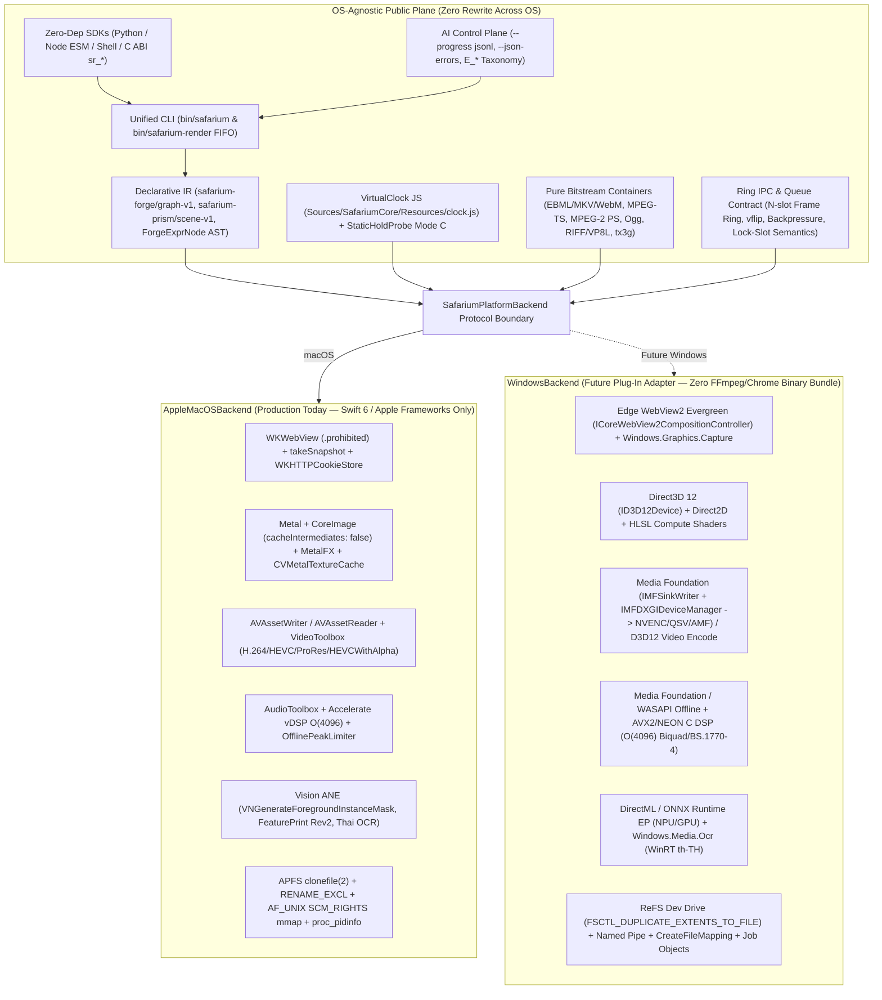

# Cross-Platform Core & Future Windows (`WebView2 + DX12 + Media Foundation`) Blueprint (2026-11-24)

> **Design Objective:** Keep **macOS Apple Silicon** (`WKWebView + Metal + VideoToolbox + AudioToolbox + Accelerate + Vision/ANE + APFS`) as Safarium's first-class, zero-compromise flagship engine, while cleanly separating **OS-agnostic Core contracts** from **`SafariumPlatformBackend`** (`AppleMacOSBackend` today vs future `WindowsBackend`). Adding Windows support later must require **zero rewrite** of the declarative IR, CLI (`safarium` / `safarium-render`), Python/Node/Shell SDKs, `VirtualClock` JS, container bitstream codecs, or AI error taxonomy.

---

## 1. Architectural Separation: OS-Agnostic Core vs `SafariumPlatformBackend`



---

## 2. Strictly OS-Agnostic Core Layers (100% Portable)

Everything in this layer operates strictly on **pure bytes, UTF-8 JSON, IEEE-754 math, ECMAScript, and C99/Swift standard types**, with zero imports of `AppKit`, `WebKit`, `Metal`, `VideoToolbox`, `CoreVideo`, `Win32`, or `DirectX`:

| Core Component | Current Safarium Source Anchor | Portable Contract Across macOS & Windows |
|---|---|---|
| **Declarative Video/Audio Graph IR** | [Sources/SafariumForgeCore/ForgeRecipe.swift](../../Sources/SafariumForgeCore/ForgeRecipe.swift) (`safarium-forge/graph-v1`), `ForgeExprNode` in [ForgeMetalFilters.swift](../../Sources/SafariumForgeCore/ForgeMetalFilters.swift) | JSON recipe schema (`inputs`, `timeline`, `videoOps`, `audioOps`, `output`, `governor`, `stagePolicy`), expression AST (`t, n, fps, dur, W, H, lt, lte, gt, gte, eq, between, if`), `1× Thai Shield` validator (`ForgeRecipeValidator`). |
| **3D Scene Interchange IR** | [Sources/SafariumPrism/PrismSceneIR.swift](../../Sources/SafariumPrism/PrismSceneIR.swift) (`safarium-prism/scene-v1`) | `PrismVec3`, `PrismQuaternion` (`wxyz` vs `xyzw`), `PrismCameraIR` (`sensorFit`, `lensMM`, `fovYDeg`), `PrismTimelineIR` (`cuts`, `hitstopFrames`, `storyToVideoTimeScale`), `.glb` sync contract. |
| **Deterministic Time Virtualization** | [Sources/SafariumCore/Resources/clock.js](../../Sources/SafariumCore/Resources/clock.js) (`VirtualClock`), `StaticHoldProbe` in [FrameSink.swift](../../Sources/SafariumCore/FrameSink.swift) | Fixed `BASE = 1704067200000` (`2024-01-01T00:00:00Z`), `Date`/`performance.now`/`document.timeline.currentTime`/`rAF`/`setTimeout`/`setInterval`/`requestIdleCallback`/WAAPI `getAnimations()`/`__seek(t)`/`__hf.seek(t)`, plus Mode C 6-signal DOM/Canvas/WebGL/SMIL mutation probe. Injected before document scripts on **both** `WKWebView` and `WebView2`! |
| **Pure Container Bitstream Codecs** | [Sources/SafariumContainers/](../../Sources/SafariumContainers/) (`EBMLMatroskaCodec`, `MPEGTSCodec` + `TSPTSUnwrapper`, `MPEG2ProgramStream`, `OggContainer` + `OggVorbisDecoder`), `WebPAVIFEncoder` RIFF/`VP8L` bitstream | Byte-level EBML VINT, 188-byte MPEG-TS packetizer & 33-bit PTS wrap, MPEG-2 PES/SCR parser, Ogg page CRC + Vorbis/FLAC packetization, RIFF `VP8L`/`VP8X`/`ANIM`/`ANMF`, and big-endian `'tx3g'` subtitle sample formatting (`[0x00,0x00]` clear cues). Only the final compressed-packet-to-surface bridge talks to `AppleMacOSBackend` or `WindowsBackend`. |
| **Zero-Copy Ring IPC Wire Protocol** | [Sources/SafariumForgeCore/ForgeSharedRingEncoder.swift](../../Sources/SafariumForgeCore/ForgeSharedRingEncoder.swift) (`ForgeRingStartSpec`), `SafariumRaster` C ABI ([ABI.swift](../../Sources/SafariumRaster/ABI.swift)) | Fixed `N`-slot (`2...64`) ring descriptor (`width`, `height`, `fps`, `pixFmt`, `vflip`, monotonic frame index + atomic slot ready/ack flags), plus flat 6-scalar `SRImage` descriptor (`data, width, height, strideBytes, channels, depth`) and `SRStatus` codes. |
| **AI Control Plane & Error Taxonomy** | [Sources/SafariumCore/Errors.swift](../../Sources/SafariumCore/Errors.swift), [docs/ai-control-protocol.md](../ai-control-protocol.md) | `--progress jsonl` stderr events, `--json-errors` (`SafariumStructuredErrorEnvelope`), and unified `SafariumErrorCode` (`E_USAGE`, `E_INPUT_MISSING`, `E_UNSUPPORTED_CODEC`, `E_QUEUE_BUSY`, `E_TIMEOUT`, `E_JS_EVAL`, `E_NAVIGATION`, `E_SNAPSHOT`, `E_ENCODE`, `E_VERIFY_FAIL`, `E_THERMAL_OR_MEM`, `E_INTERNAL`). |
| **Pure C99 / SIMD Kernel Layer** | [Sources/SafariumRasterC/](../../Sources/SafariumRasterC/) (`webp_ll.c`, `webp_vp8.c`, `deflate_fast.c`, `jpeg_*.c`) | Portable C99 still encoders & pixel conversions (`#ifdef __aarch64__` NEON today, cleanly extensible with `#ifdef __AVX2__` / scalar fallbacks on Windows x64/ARM64). |

---

## 3. Protocol Surface: `SafariumPlatformBackend` (`PlatformBackend.swift` Contract)

Every OS-dependent operation in Safarium resolves through a clean Swift protocol suite (aligned with Wave 7's `Sources/SafariumCore/PlatformBackend.swift` architecture):

```swift
public struct SafariumPlatformCapabilities: Codable, Sendable, Equatable {
    public let osName: String                 // "macOS" | "Windows"
    public let arch: String                   // "arm64" | "x86_64"
    public let webEngine: String              // "WKWebView" | "EdgeWebView2"
    public let gpuBackend: String             // "Metal" | "Direct3D12" | "None"
    public let hasHardwareGPU: Bool           // false if headless VM MTLCreateSystemDefaultDevice()==nil
    public let videoEncoderBackend: String    // "VideoToolbox" | "MediaFoundation" | "D3D12Video"
    public let mlAccelerator: String          // "AppleNeuralEngine" | "DirectML" | "CPU"
    public let hasHardwareNPU: Bool           // false in macOS Virtualization.framework VMs
    public let supportedVideoEncoders: [String] // macOS: ["h264","hevc","hevc-alpha","prores422","prores4444"]
                                                // Windows: ["h264","hevc","av1"]
    public let supportedCoWFilesystem: Bool   // APFS clonefile vs ReFS FSCTL_DUPLICATE_EXTENTS_TO_FILE
    public let supportsHardwareAlphaEncode: Bool
}

public protocol WebFrameRendererBackend: Sendable {
    @MainActor func createSession(config: WebBackendConfig) async throws -> WebSessionHandle
    @MainActor func installStartupScript(_ script: String, session: WebSessionHandle) async throws
    @MainActor func load(_ source: WebSource, session: WebSessionHandle) async throws
    @MainActor func evaluate(_ js: String, session: WebSessionHandle) async throws -> Any?
    @MainActor func captureFrameRGBA(session: WebSessionHandle, width: Int, height: Int) async throws -> RawFrameBuffer
    @MainActor func close(session: WebSessionHandle) async
}

public protocol VideoEncoderBackend: Sendable {
    func supports(codec: String, pixelFormat: String) -> Bool
    func makeSink(spec: VideoSinkSpec) throws -> FrameSink
}

public protocol FilesystemCloneBackend: Sendable {
    func inspectVolume(at url: URL) throws -> VolumeCapabilities
    func cloneFile(from src: URL, to dst: URL) throws -> Bool // true = zero-byte CoW clone; false = fallback copy
}

public protocol ProcessTelemetryBackend: Sendable {
    func sampleProcessTreeFootprintBytes(rootPIDs: [Int32]) -> UInt64
    func currentThermalPressure() -> ThermalPressureLevel
}

public protocol SafariumPlatformBackend: Sendable {
    func capabilities() -> SafariumPlatformCapabilities
    var webRenderer: WebFrameRendererBackend { get }
    var videoEncoder: VideoEncoderBackend { get }
    var filesystem: FilesystemCloneBackend { get }
    var telemetry: ProcessTelemetryBackend { get }
}
```

### Non-Negotiable Behavioral Invariants Across Backends
1. **Fail Fast — Never Silently Fallback Across Incompatible Specs:** If `WindowsBackend` receives `--codec prores4444` or `--codec hevc-alpha` without a registered compliant backend encoder, it MUST throw `SafariumErrorCode.E_UNSUPPORTED_CODEC` with an actionable hint (`"Windows Media Foundation does not support ProRes 4444; choose h264, hevc, or av1"`), mirroring macOS's explicit `AV1`/`VP9`/`MP3` refusal.
2. **Headless VM Safety:** On macOS CI VMs where `MTLCreateSystemDefaultDevice() == nil`, `AppleMacOSBackend.capabilities()` reports `hasHardwareGPU = false`, `gpuBackend = "None"` instead of force-unwrapping `nil`, allowing pure CPU/CoreGraphics/Accelerate paths to run and GPU-only paths to return typed `E_UNSUPPORTED_CODEC` / `E_INTERNAL` errors.
3. **One-Slot Queue Guarantee (`SF-VIDEO-1`):** macOS enforces FIFO via `fcntl`/`flock` in `~/.safarium-render-queue` + `proc_pidinfo` session verification; Windows enforces the identical semantic via a named mutex (`Global\SafariumRenderSlot-<SID>`) + Win32 Job Object (`JOB_OBJECT_LIMIT_KILL_ON_JOB_CLOSE`) to guarantee clean worker tree teardown on cancellation or `Ctrl-C`.

---

## 4. Why Safari / WebKit Does NOT Exist on Windows — and Why `Edge WebView2` is the Clean Future Adapter

### 4.1 Why Native WebKit Fails as a Windows System Engine
1. **Apple Discontinued Safari for Windows in 2012 (`v5.1.7`):** There is no Apple-maintained browser runtime, security auto-updater, or system `WKWebView` framework on Windows (`learn.microsoft.com` / WebKit port history).
2. **`WinCairo` Port Lacks System Integration:** Open-source WebKit maintains a `WinCairo` developer port (used by WebKit CI bots and Playwright's bundled WebKit test binary), but:
   - It swaps Apple's `CoreGraphics`/`CoreAnimation`/`CoreText`/`Metal`/`IOSurface`/`VideoToolbox` stack for bundled **Cairo + ANGLE + HarfBuzz + libcurl + GStreamer/MediaFoundation glue** (`WebKitRequirementsWin64`).
   - Shipping `WinCairo` forces Safarium to bundle, patch, and update hundreds of megabytes of third-party DLLs — **the exact bloated-browser anti-pattern Safarium was built to eliminate!**
   - `WinCairo` lacks tight OS compositor zero-copy integration (`DirectComposition` / `Windows.Graphics.Capture` surface sharing).

### 4.2 Why Microsoft Edge `WebView2` Is the Ideal `WindowsBackend` Counterpart to `WKWebView`
| Property | macOS: `WKWebView` (`AppleMacOSBackend`) | Windows: `Edge WebView2` (`WindowsBackend`) |
|---|---|---|
| **Deployment Model** | Pre-installed in macOS OS (`/System/Library/Frameworks/WebKit.framework`), **`0 B`** app payload | **Evergreen Runtime** pre-installed on Windows 11 & auto-updated by Microsoft (`0 B` browser payload in Safarium!) |
| **Windowless / Focus-Safe Hosting** | `NSApplication.shared.setActivationPolicy(.prohibited)` + offscreen `WKWebView` | `ICoreWebView2Environment::CreateCoreWebView2CompositionController` (visual-tree hosting without visible top-level activation / focus stealing) |
| **Startup Script Injection (`VirtualClock`)** | `WKUserScript(..., injectionTime: .atDocumentStart, forMainFrameOnly: false)` | `ICoreWebView2::AddScriptToExecuteOnDocumentCreated` (runs `clock.js` before any page script!) |
| **Zero-Copy Frame Capture** | `takeSnapshot` / `IOSurface`-backed `CVPixelBuffer` | `Windows.Graphics.Capture` (`Direct3D11CaptureFramePool` from composition visual / HWND) -> `ID3D11Texture2D` -> `ID3D12Resource` shared handle |
| **Hardware WebGL2 / WebGPU** | WebKit ANGLE over **Metal** | Chromium/Edge ANGLE over **Direct3D 11 / 12** |
| **Cookie / Network Governance** | `WKHTTPCookieStore` + `WKWebsiteDataStore.nonPersistent()` | `ICoreWebView2CookieManager` + ephemeral `ICoreWebView2EnvironmentOptions` user-data-dir in temp |

> **Honest Cross-OS Visual Parity Caveat:** `WKWebView` uses WebKit + `CoreText`/macOS system Thai fonts (`Sukhumvit Set`, `Thonburi`), whereas `WebView2` uses Blink + `DirectWrite` + Windows Thai fonts (`Leelawadee UI`, `Tahoma`). Therefore, pixel parity (`SSIM >= 0.97`, `ΔE00 p95 <= 2.0`) is guaranteed **within each OS** unless `--font-dir` embeds identical TTF/OTF webfont files across both platforms (and even then, DirectWrite vs CoreText subpixel antialiasing yields minor glyph-edge deltas).

---

## 5. Full 1-to-1 Subsystem Adapter Mapping (`AppleMacOSBackend` vs `WindowsBackend`)

| Safarium Subsystem | macOS Implementation (`AppleMacOSBackend`) | Windows Implementation (`WindowsBackend`) | Key Cross-OS Engineering Delta |
|---|---|---|---|
| **Web HTML/DOM/WebGL Frame Renderer** | `WKWebView` + `VirtualClock` + `StaticHoldProbe` (`Page.swift`) | `Edge WebView2` (`ICoreWebView2CompositionController`) + `Windows.Graphics.Capture` + `VirtualClock` | `<video>` elements inside WebView2 composition mode may render in hardware overlay planes; `clock.js` `videoSeekHook` + `drawImage(video)` or MF `IMFSourceReader` `.extract` fallback handles `<video>` identically to macOS `.extract`/`.element`! |
| **GPU Compositor & Filters** | `Metal` (`SafariumMetalContext`, `ForgeMetalFilters`, `SafariumPQEngine`) + `CoreImage` (`cacheIntermediates: false`) | **Direct3D 12** (`ID3D12Device`) + **HLSL Compute Shaders** (compiled DXIL) + **Direct2D** (`ID2D1DeviceContext`) | Apple Unified Memory allows zero-copy `CVMetalTextureCache`; Windows discrete GPUs (`NV`/`AMD`) require an explicit ring of upload/readback `D3D12_HEAP_TYPE_READBACK` heaps (`<= 4` slots) unless running on integrated UMA APUs. |
| **Hardware Video Encode** | `VideoToolbox` / `AVAssetWriter` (`h264`, `hevc`, `hevc-alpha`, `prores422`, `prores4444`) | **Media Foundation** (`IMFSinkWriter` + `IMFDXGIDeviceManager` -> NVENC / QSV / AMF) + **Win11 `D3D12 Video Encode`** (WDDM 3.2 H.264/HEVC/AV1) | Windows gains **hardware AV1 encode** (RTX 40 / Intel Arc / Radeon RX 7000+); Windows **lacks native OS `ProRes 4444` & `HEVCWithAlpha` (`muxa`)** — use `AV1/VP9 + alpha` or RGBA/FFV1/PNG-alpha sequence policy if alpha export is requested on Windows, or fail with `E_UNSUPPORTED_CODEC`. |
| **Hardware Video Decode** | `AVAssetReader` / `VTDecompressionSession` (`SequentialVideoReader.swift`) | Media Foundation `IMFSourceReader` (`MF_SOURCE_READER_D3D_MANAGER`) / `D3D12 Video Decode` | Identical sequential sample cursor abstraction feeding `VideoReader` / `MediaGraph` ops; Windows decodes `AV1`/`VP9`/`HEVC`/`H.264` natively on hardware without `VTRegisterSupplementalVideoDecoderIfAvailable`. |
| **Audio DSP & Mastering** | `AudioToolbox` + `Accelerate vDSP` (`vDSP_biquadD` `O(4096)`, gated `BS.1770-4`, `4×` `dBTP`, `OfflinePeakLimiter`) | Media Foundation AAC/PCM + WASAPI offline + portable **C99/SIMD (`SafariumAudioC`)** implementing identical `O(4096)` `biquad` + `BS.1770-4` + `OfflinePeakLimiter` | Extract the pure math coefficients & state structs from `ForgeAudioDSP.swift` (`[b0,b1,b2,a1,a2]` RBJ cookbook, 616B BS.1770-4 gating state) into portable C99/Swift so numeric outputs match `max_abs_error < 1e-6` across OSes! |
| **ML Cutout, Reframe & OCR** | `Vision` (`VNGenerateForegroundInstanceMask`, `VNRecognizeTextRequest` Thai) on **ANE** | **DirectML / ONNX Runtime** (DirectML EP targeting GPU/NPU) + **`Windows.Media.Ocr`** (`WinRT` `OcrEngine` `th-TH`) | Keep `SafariumPQ` MS-SSIM & Sharma-2005 CIEDE2000 identical in HLSL (`pLuma`/`pDE00`); `aneFeatureDistance` becomes optional/platform-tagged in `SafariumPQReport`. |
| **2D Raster & `cv2` Shim (`SafariumRaster`)** | Swift + `SafariumRasterC` (NEON) + `Accelerate` (`BLAS`/`LAPACK`/`vDSP`/`vImage`) + `ImageIO` + opt-in `Metal` (`sr_gpu_*`) | Swift-on-Windows + `SafariumRasterC` (AVX2/NEON) + OpenBLAS/MKL or portable C LAPACK + `WIC` (Windows Imaging Component) + opt-in `D3D12` compute | `SafariumRaster`'s custom C99 codecs (`webp_ll.c`, `webp_vp8.c`, `jpeg_*.c`, `deflate_fast.c`) and `SRImage` C ABI are **already 90% OS-independent!** Only `Accelerate` & `ImageIO`/`VideoReader` need Windows shims (`WIC` + `IMFSourceReader`). |
| **CoW Scene Cache & Staging** | `APFS` `clonefile(2)` + `RENAME_EXCL` (`APFSAutoStage` bypasses ExFAT) | **`ReFS` Dev Drive `FSCTL_DUPLICATE_EXTENTS_TO_FILE`** (`DeviceIoControl`, 4 KB cluster aligned) with `CopyFileEx` fallback on NTFS/ExFAT | `ReFS` block cloning requires **4 KB cluster alignment** on byte offsets/extents; whole-file cache cloning pads/aligns segment lengths or uses Win11 `CopyFile2` with ReFS auto-reflink! |
| **IPC Ring & Process Tree Telemetry** | `AF_UNIX` + `SCM_RIGHTS` unlinked `mmap` + `proc_listallpids`/`proc_pidinfo(PROC_PIDTBSDINFO)` | Win32 Named Pipe (`\\.\pipe\safarium-*`) + `CreateFileMapping`/`DuplicateHandle` + **Win32 Job Objects** (`QueryInformationJobObject`) | Win32 Job Objects solve `WebView2`'s multi-process child footprint problem (`msedgewebview2.exe` tree) natively without walking `proc_listallpids`! |

---

## 6. Phased Execution Roadmap (Zero Public Contract Breakage)

1. **Phase A — MacOS Backend Isolation (Now / Wave 7):**
   - Land `Sources/SafariumCore/PlatformBackend.swift` (`AppleMacOSBackend` + `SafariumPlatformCapabilities` + `hasHardwareGPU` / `hasHardwareNPU` probes).
   - Route `safarium-render capabilities`, `safarium doctor --json`, and `ForgeMetalFilters` device checks through `PlatformBackend` so macOS Cloud VMs never crash on `nil` Metal/ANE.
2. **Phase B — Portable Core Extraction (Pre-Windows):**
   - Isolate `Sources/SafariumContainers/` pure bitstream logic (already almost free of `AVFoundation` except the final `.mp4` bridge) and extract `ForgeAudioDSP`'s `O(4096)` biquad / `BS.1770-4` / `OfflinePeakLimiter` math + `SafariumRasterC` into `SafariumCoreC` (pure C99, zero Apple headers).
   - Parameterize `VirtualClock` (`clock.js`) `videoSeekHook` messaging so both `window.webkit.messageHandlers.sfVideo` (macOS) and `window.chrome.webview.postMessage` (WebView2) sit behind one 10-line JS transport adapter inside `clock.js`.
3. **Phase C — `WindowsBackend` Implementation (`Swift-on-Windows` + WinRT/COM C++ Shim):**
   - Implement `WindowsWebView2Renderer` (`ICoreWebView2CompositionController` + `Windows.Graphics.Capture`), `WindowsMediaFoundationEncoder` (`IMFDXGIDeviceManager` + `NVENC`/`QSV`/`AMF` + `D3D12 Video`), `WindowsHLSLCompositor`, and `WindowsReFSFilesystemBackend` (`FSCTL_DUPLICATE_EXTENTS_TO_FILE`).
   - Run identical `safarium-forge/graph-v1` recipes & `SafariumPQ` verification gates across both OSes without changing a single line of user Python/Node/CLI scripts!

---

## 7. Verified Sources & References

- **Repo Files Read & Referenced:**
  - [docs/superpowers/specs/2026-11-24-safarium-unified-cloud-rd-design.md](../superpowers/specs/2026-11-24-safarium-unified-cloud-rd-design.md)
  - [Sources/SafariumCore/Errors.swift](../../Sources/SafariumCore/Errors.swift) · [Sources/SafariumCore/VirtualClock.swift](../../Sources/SafariumCore/VirtualClock.swift) · [Sources/SafariumCore/Resources/clock.js](../../Sources/SafariumCore/Resources/clock.js) · [Sources/SafariumCore/Page.swift](../../Sources/SafariumCore/Page.swift) · [Sources/SafariumCore/FrameSink.swift](../../Sources/SafariumCore/FrameSink.swift) · [Sources/SafariumCore/MetalContext.swift](../../Sources/SafariumCore/MetalContext.swift) · [Sources/SafariumCore/Host.swift](../../Sources/SafariumCore/Host.swift)
  - [Sources/SafariumContainers/ContainerInterfaces.swift](../../Sources/SafariumContainers/ContainerInterfaces.swift) · [EBMLMatroska.swift](../../Sources/SafariumContainers/EBMLMatroska.swift) · [MPEGTSContainer.swift](../../Sources/SafariumContainers/MPEGTSContainer.swift) · [MPEG2ProgramStream.swift](../../Sources/SafariumContainers/MPEG2ProgramStream.swift)
  - [Sources/SafariumForgeCore/ForgeRecipe.swift](../../Sources/SafariumForgeCore/ForgeRecipe.swift) · [ForgeSharedRingEncoder.swift](../../Sources/SafariumForgeCore/ForgeSharedRingEncoder.swift) · [ForgeIncrementalCache.swift](../../Sources/SafariumForgeCore/ForgeIncrementalCache.swift) · [ForgeAudioDSP.swift](../../Sources/SafariumForgeCore/ForgeAudioDSP.swift)
  - [Sources/SafariumPrism/PrismSceneIR.swift](../../Sources/SafariumPrism/PrismSceneIR.swift) · [Sources/SafariumRaster/ABI.swift](../../Sources/SafariumRaster/ABI.swift)
- **External Specifications Verified (`2026-11-24`):**
  - Microsoft Learn — Edge `WebView2` Evergreen Runtime, `ICoreWebView2CompositionController`, `Windows.Graphics.Capture` (`Direct3D11CaptureFramePool`), `D3D12 Video Encode API` (Windows 11 / WDDM 3.2 AV1), `Media Foundation` `IMFDXGIDeviceManager`, and `ReFS` Block Cloning (`FSCTL_DUPLICATE_EXTENTS_TO_FILE`) (`learn.microsoft.com`, `github.com/MicrosoftEdge/WebView2Samples`)
  - WebKit WinCairo / Apple Safari for Windows 5.1.7 end-of-life context (`webkit.org` / `darpinian.com`)
  - Khronos Group — Vulkan Video Encode (`VK_KHR_video_encode_{h264,h265,av1}`) (`khronos.org`)

