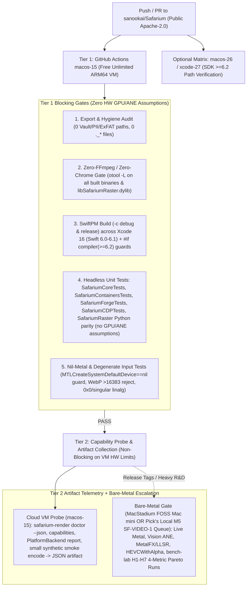

# Free Cloud macOS Runners Survey & 2-Tier CI Strategy (2026-11-24)

> **Purpose:** Map every free or open-source-grant Cloud macOS CI/CD option so **Safarium** (`https://github.com/sanookai/Safarium`, Apache-2.0) can build, test, and verify away from Pick's personal M5 Mac—while accounting rigorously for Apple `Virtualization.framework` / Tart hypervisor boundaries (no physical ANE, restricted/nullable Metal GPU, Xcode SDK differences, and VM memory/disk ceilings). All provider quotas, retirements, and specs below were verified via live web search on `2026-11-24`.

---

## 1. Exhaustive Free & Open-Source Cloud macOS Runner Matrix

| Provider | Free Tier & Public Repo Quota | Private Repo Quota / Multiplier | Hardware & macOS Labels | Practical Monthly Ceiling & Eligibility Gotchas |
|---|---|---|---|---|
| **GitHub Actions** (`docs.github.com`, `actions/runner-images`) | **Public repos: Free & unlimited** minutes (subject to standard concurrency caps & fair-use policy). | **Private/internal repos:** Draws from account monthly minutes at a **`10×` minute multiplier** (`1×` Linux, `2×` Windows, `10×` macOS) — e.g., Free plan's `2,000` Linux min = **`200` macOS min/mo**. `-large`/`-xlarge` runners are **never free** (strictly metered). | **Standard ARM64:** `macos-15`, `macos-latest`, `macos-26`, `xcode-27` — **3 vCPU (M1/M2 class), 7 GB RAM, 14 GB SSD** *(official GitHub Docs specs; `runner-images` hosts ~14 GB stated / ~35–55 GB free only after purging simulators)*. **Standard Intel:** `macos-15-intel`, `macos-26-intel` (4 vCPU, 14 GB RAM). **Larger (paid):** `macos-*-xlarge` (5 Apple Silicon CPU + 8 GPU, 14 GB RAM). | **CRITICAL LIFECYCLE UPDATE:** **`macos-14` (Sonoma) was officially retired on November 2, 2026** (`macos-14`, `macos-14-large`, `macos-14-xlarge` decommissioned). Workflows must target `macos-15` / `macos-latest` (Xcode 16.x / Swift 6.0–6.1) or `macos-26`! **Best primary Tier 1/Tier 2 cloud CI** for public Apache-2.0 `sanookai/Safarium`. |
| **Cirrus CI / Cirrus Runners + Tart** (`cirruslabs.org`, `tart.run`) | **MANAGED CLOUD SHUT DOWN:** **Cirrus CI officially ceased operations on June 1, 2026** following Cirrus Labs' April 7, 2026 agreement to join OpenAI; Cirrus Runners stopped accepting new customers. | N/A (managed Cirrus cloud discontinued). | **Tart (`github.com/cirruslabs/tart`)** remains **open source** (OCI macOS VM images wrapping Apple `Virtualization.framework` for Sonoma/Sequoia). | Cannot be used as a free hosted SaaS anymore. **Self-hosted legacy:** Tart remains the gold-standard free local/bare-metal runner orchestrator if paired with an owned or MacStadium-sponsored Mac mini (capped at **2 concurrent guest macOS VMs per physical Apple Silicon host** by Apple EULA). |
| **Codemagic** (`codemagic.io`) | **Free Plan (individuals):** **`500` free macOS build minutes / month** (refreshes on the 1st of every month; works for public & private repos). No separate unlimited FOSS tier beyond the 500-min pool. | Same `500` free min/mo individual pool; beyond free quota PAYG: **Mac mini M2 `$0.095/min`**, **Mac mini M4 `$0.114/min`**. | **Mac mini M2** on Free Plan (**1 parallel build max**). | Solid secondary backup runner for quick Xcode/SwiftPM cross-checks if GitHub Actions experiences queue delays; 500 min/mo exhausts quickly if building full SwiftPM caches cold without cache reuse. |
| **CircleCI** (`circleci.com`) | **Free & Open Source Plans:** Open-source projects get `400,000` credits/mo for Linux/Docker/Arm, **but macOS & Windows remain capped at `30,000` credits / month** (`1 credit = $0.0006`). | Same `30,000` credits/mo on Free tier. | **`m4pro.medium`** (6 vCPU, 28 GB RAM) = **`200` credits/min** (**`150` free macOS min/mo**). **`m4pro.large`** (12 vCPU, 56 GB RAM) = **`400` credits/min** (**`75` free macOS min/mo**). *(M1/M2 classes deprecated.)* | Fast M4 Pro CPUs & **28 GB RAM** (4× more RAM than GitHub's 7 GB standard VM!), ideal as an occasional manual/nightly heavy-compile overflow runner (`150 min/mo` cap). |
| **Azure Pipelines** (`learn.microsoft.com`) | **Public FOSS Grant:** Free public builds (up to 10 parallel jobs) **require submitting a manual Microsoft grant request** (auto-grant disabled to curb crypto-mining abuse). | **Private projects:** **`1,800` free minutes / month** (1 parallel Microsoft-hosted job). | Microsoft-hosted **`macOS-15`** (Sequoia) and transitioning/retiring `macOS-14` pools. | Manual grant approval delay; slower macOS provisioning and tighter per-job timeouts than GitHub Actions; useful mainly if `sanookai/Safarium` needs an extra Microsoft-ecosystem mirror. |
| **Bitrise** (`bitrise.io`) | **Open Source Plan:** **Unlimited builds/minutes** for verified public FOSS repos (public logs, secret redaction, fair-use concurrency). **Hobby Plan:** **`500` free minutes / month** across Linux & macOS. | Hobby `500` min/mo pool (typically requires anti-abuse card verification; **M2 Pro** runners restricted to paid Starter/Pro tiers). | Managed macOS VMs (standard shared tier on Hobby/OSS; M2 Pro Medium/Large on paid tiers). | Strong **secondary public FOSS CI** for Xcode/SwiftPM checks, though pipeline config (`bitrise.yml`) is mobile/iOS-centric rather than generic CLI/media benchmarking. |
| **MacStadium Open Source Program** (`macstadium.com/company/opensource`) | **Free bare-metal cloud Mac mini** (including Apple Silicon options) with full root access (`0%` hypervisor tax!). | N/A (FOSS-only). | **Physical bare-metal Mac mini** (hosts self-hosted GitHub Actions / GitLab / Tart runners with **real Metal GPU, VideoToolbox, and ANE**!). | **Strict eligibility & capacity waitlist:** Must use an OSI-approved license, be 100% free (no open-core/commercial backing), maintained by unpaid lead/contributors, and approved through MacStadium's capacity-gated FOSS queue. **Strategic Tier 2 target once `sanookai/Safarium` goes public!** |
| **Reference Only: GitLab SaaS & AWS EC2 Mac** | **GitLab Free:** `400` min/mo covers **Linux/Windows only**; `saas-macos-medium-m1` requires Premium/Ultimate or GitLab OSS Program (`6×–12×` multiplier). **AWS `mac2.metal`:** **$0 free tier.** | GitLab Free can connect a **self-hosted** Mac mini via `gitlab-runner` for unlimited minutes. AWS EC2 Mac enforces **Apple's 24-hour minimum dedicated host lease** (~`$15–$26+/day`). | Apple Silicon Mac mini bare-metal (AWS) / virtualized M1 (GitLab). | Exclude AWS EC2 Mac from free CI; use GitLab only if migrating away from GitHub. |

---

## 2. Exact Apple `Virtualization.framework` & Cloud macOS VM Constraints

Standard Cloud macOS CI runners (`GitHub Actions`, `Codemagic`, `CircleCI`, `Bitrise`, `Azure Pipelines`, and self-hosted `Tart`) run inside macOS guest VMs managed by Apple's `Virtualization.framework` (or commercial hypervisors like Anka/Orka). **Safarium's code and CI tests MUST respect 6 physical hypervisor boundaries:**

### 2.1 Metal GPU (`MTLCreateSystemDefaultDevice()`)
- **The Trap:** On headless or pre-Sequoia (`macos-14` / Intel paravirtualized) macOS VMs, **`MTLCreateSystemDefaultDevice()` can return `nil`**, or bind to a conservative paravirtualized graphics profile (`Apple Paravirtualized Graphics Device`, ~64 MB VRAM on Intel, or reduced `MTLGPUFamily` capabilities on ARM64 without full bare-metal shader/throughput parity).
- **Mandatory Code Guard (`SafariumCore`, `SafariumForgeCore`, `SafariumPrism`, `SafariumRaster`):**
  1. Never force-unwrap `MTLCreateSystemDefaultDevice()!` anywhere in production or test targets.
  2. Probe `MTLCreateSystemDefaultDevice() ?? MTLCopyAllDevices().first`, and if `nil`, return a structured `SafariumError` (e.g., `.invalidState("Metal unavailable")` -> `E_UNSUPPORTED_CODEC` / capability `hasMetalGPU = false`) rather than crashing with `SIGTRAP`.
  3. In XCTest (`SafariumCoreTests`, `SafariumForgeTests`, `SafariumPrismTests`), wrap GPU compute assertions with `try XCTSkipUnless(backend.hasMetalGPU, "Skipping live Metal assertion on headless VM")` while **still testing that the error path returns cleanly when Metal is `nil`**.

### 2.2 Apple Neural Engine (ANE)
- **Zero Hypervisor Passthrough:** Apple's `Virtualization.framework` **does NOT expose the physical Apple Neural Engine (`ANE`) to macOS guest VMs**.
- **Runtime Effect:** `Vision` requests (`VNGenerateForegroundInstanceMaskRequest`, `VNGenerateImageFeaturePrintRequest`, `VNRecognizeTextRequest`) either fall back to CPU/virtual GPU (`aneDeviceActive == false` in `SafariumPQReport`) or fail model asset loading on headless VMs.
- **CI Rule:** Never assert `aneDeviceActive == true` or `personMatte` millisecond latency thresholds inside Cloud VMs (`Tier 1`). Verify API wiring + graceful fallback only.

### 2.3 VideoToolbox & Hardware Codecs
- **Paravirtualized Media Engine Variance:** `VTCompressionSession` / `AVAssetWriter` hardware behavior inside multi-tenant VMs does **not** reflect bare-metal M5 Media Engine throughput, thermal behavior, or `CQF` rate-control tuning.
- **OS/SDK Version Walls:**
  - `VTLowLatencySuperResolutionScalerConfiguration`, `VTFrameProcessor`, `VTFrameProcessorFrame`, `VTLowLatencySuperResolutionScalerParameters`, `CIContextOption.cvMetalTextureCache`, and `AVAssetWriterInput.mediaDataLocation = .sparselyInterleavedWithMainMediaData` are **macOS 26+ SDK symbols** (present on Pick's local M5 macOS `27.2` / Swift `6.4.2`, **absent on GitHub Actions `macos-15` Xcode 16 / Swift 6.0–6.1!**).
  - **Mandatory Compile Guard:** Every macOS 26+ SDK API MUST be wrapped in **both** `#if compiler(>=6.2)` (compile-time guard) **and** `if #available(macOS 26.0, *)` (runtime guard)! Without `#if compiler(>=6.2)`, `swift build` immediately fails on Xcode 16 (`macos-15`)!
  - Similarly, macOS 15+ SDK APIs (`AVAudioFile.close()`, `kVTCompressionPropertyKey_SuggestedLookAheadFrameCount`) compile on `macos-15` (Xcode 16 / Swift 6.0+), and should only need `#if compiler(>=6.0)` if targeting legacy Xcode 15.4 / Swift 5.10.
  - Offline MobileAsset dependency: `VTSuperResolution` fails offline (`-19743`) even on bare-metal without cached models, so CI never tests `VTSuperResolution` download paths.

### 2.4 RAM, Disk, and Concurrency Ceilings on GitHub `macos-15`
- **7 GB RAM Ceiling (`macos-15` standard ARM64):** Compiling large SwiftPM targets + running parallel XCTest workers + spawning `WKWebView` `WebContent` XPC processes concurrently can hit macOS `jetsam` / swap thrashing under 7 GB.
  - **Mitigation:** Run SwiftPM builds with `-j 2` or `-j 3` if needed, run `swift test --no-parallel` (matching `SF-VIDEO-1` serial execution!), and keep `WKWebView` test pages lightweight (`256×256` or `320×240` for functional unit checks rather than 4K multi-tab).
- **14 GB Stated SSD / Simulator Bloat:** Standard `runner-images` pack multiple Xcode versions and iOS/tvOS/watchOS/visionOS simulators.
  - **Mitigation:** Reclaim `20–40 GB` at job start when disk is tight (`xcrun simctl delete all` or selective cleanup if needed) and always use `--scratch-path /tmp/safarium-ci-build` + `actions/cache` for `.build` artifacts bounded to release/debug targets under test.
- **No Wall-Clock Performance Benchmarking on Shared VMs:** Virtualized CPU/GPU noisy neighbors invalidate `ms/frame`, `ΔE00` timing, and `ri_phys_footprint` hardware comparisons. Cloud VMs verify **correctness, determinism (`3-run identical hash`), ABI safety, and capability reporting** — never Speed Pareto victories!

---

## 3. Clean 2-Tier Cloud CI Verification Strategy for `sanookai/Safarium`

### 3.1 Tier 1 — Blocking Headless Cloud Verification (Every Push & PR)
Runs on **`macos-15`** (free & unlimited for public `sanookai/Safarium`, plus optional **`macos-26`** job to exercise `#if compiler(>=6.2)` paths remotely):
1. **Static & Binary Hygiene (`< 30 s`):**
   - Fail if any `._*` AppleDouble files, an external ExFAT volume, personal Vault paths, or secret tokens appear in the tree.
   - Verify `otool -L` across `safarium-html`, `safarium-cdp`, `safarium-media`, `safarium-forge`, `safarium-bench`, `safarium-regions`, and `libSafariumRaster.dylib` links **strictly** `/System/Library/*` and `/usr/lib/*` (`0` FFmpeg/libav/Chrome/OpenCV libs).
2. **Dual-SDK Compilation Verification (`~2–4 min` cached):**
   - `swift build --scratch-path /tmp/safarium-ci-build` cleanly builds every target on Xcode 16 (`macos-15`, validating `#if compiler(>=6.2)` guards on macOS 26+ APIs).
   - Build `SafariumRaster` dynamic library (`swift build -c release --product SafariumRaster`) and compile C kernels (`Sources/SafariumRasterC/*.c`) with `-fsanitize=address,undefined` test harness to guarantee zero buffer overflow/UB in `webp_ll.c`, `webp_vp8.c`, `jpeg_*.c`, `core_neon.c`.
3. **Deterministic Core, Containers, Queue, CDP & Raster Tests (`~2–3 min`):**
   - `swift test --no-parallel --scratch-path /tmp/safarium-ci-build` covering:
     - `VirtualClock` (`clock.js`) determinism across 3 consecutive ticks/runs + timeout cancellation.
     - Pure-Swift `SafariumContainers`: EBML/MKV/WebM mux/demux, MPEG-TS 33-bit PTS wrap, MPEG-2 PS, Ogg Vorbis/FLAC decode, `tx3g` subtitle sample packing.
     - `ForgeIncrementalCache` recursive deterministic directory hashing (`._*` skip, symlink containment) & `APFS` `clonefile` on runner local disk.
     - `PlatformBackend` contract & graceful `MTLCreateSystemDefaultDevice() == nil` error path.
     - `SafariumRaster` Python `ctypes` parity tests (CPU `1`-thread `SRImage`, WebP 14-bit policy `<= 16383` & `<= 2^27 px` pre-alloc rejection, Phase 2 Accelerate `linalg`/`transforms`, Phase 3 `imgproc`).
     - Queue safety (`Tests/queue/test_queue.py` FIFO locking, nested refusal exit `64`, direct `ffmpeg`/`chrome` refusal).

### 3.2 Tier 2 — Cloud Capability Probe + Bare-Metal Hardware Release Gate
Runs on `macos-15` (non-blocking hardware probe artifacts) + **MacStadium FOSS Mac mini** (if approved) or **Pick's M5 bare-metal** on release tags:
- **Cloud `macos-15` Tier 2 Job:**
  - Runs `bin/safarium capabilities`, `bin/safarium doctor --json`, and `PlatformBackend` telemetry, uploading exact `hasMetalGPU`, `hasANE`, `xcodeVersion`, `swiftVersion`, and `availableVideoCodecs` as workflow JSON artifacts (`actions/upload-artifact`).
  - Attempts a minimal `256×256` 10-frame `WKWebView` + `AVAssetWriter` H.264 smoke render **only if** `capabilities` reports a functional video encoder on the VM; logs `SKIPPED (VM limit)` rather than failing PRs if paravirtualized `VideoToolbox`/`WKWebView` graphics aren't backed by host silicon.
- **Backup Free Quota Distribution (If GitHub Actions Queue Spikes or Needs M2/M4 Check):**
  - **Bitrise Open Source Plan:** Mirror `SafariumCore`/`SafariumContainers` XCTest checks (`unlimited` public FOSS minutes).
  - **CircleCI (`m4pro.medium`, 28 GB RAM):** Monthly/release tag heavy Release build + ASan full suite (`<= 150 min/mo` within 30,000 free credits).
  - **Codemagic (`500 min/mo` M2):** Ad-hoc M2 silicon verification.
  - **MacStadium FOSS Application (`https://www.macstadium.com/company/opensource`):** Apply once `https://github.com/sanookai/Safarium` is live and Apache-2.0 compliant to unlock **bare-metal Apple Silicon Metal + VideoToolbox + ANE CI** completely off Pick's local Mac!

---

## 4. Verified Sources

- GitHub Docs — Standard GitHub-hosted runners (`macos-15`, `macos-latest`, `macos-26`, `xcode-27`, public unlimited vs private `10×` minute multiplier, `macos-14` November 2, 2026 retirement) (`docs.github.com`, `github.blog`)
- GitHub `actions/runner-images` — `macos-15-arm64-Readme.md`, Xcode versions, disk reclamation, and `MTLCreateSystemDefaultDevice()` vs `MTLCopyAllDevices()` behavior on virtualized macOS runners (`github.com/actions/runner-images`)
- Cirrus Labs — Official announcement joining OpenAI (April 7, 2026) & Cirrus CI shutdown (June 1, 2026) (`cirruslabs.org`); Tart open-source Apple `Virtualization.framework` Metal/ANE constraints (`tart.run`, `github.com/cirruslabs/tart`)
- Codemagic Pricing — `500` free Mac mini M2 minutes/month (`codemagic.io`)
- CircleCI Pricing & Open Source Docs — `30,000` free credits/month on macOS (`m4pro.medium` 200 credits/min, `m4pro.large` 400 credits/min) vs `400,000` Linux credits (`circleci.com`)
- Microsoft Learn — Azure Pipelines `1,800` private min/month & manual FOSS grant policy, `macOS-15` agent pool (`learn.microsoft.com`)
- Bitrise Pricing & Open Source Docs — `500` min/mo Hobby plan & unlimited public FOSS builds (`bitrise.io`)
- MacStadium Open Source Program — Bare-metal Mac mini FOSS sponsorship (`https://www.macstadium.com/company/opensource`)
- Repo Design & Implementation Context — [docs/superpowers/specs/2026-11-24-safarium-unified-cloud-rd-design.md](../superpowers/specs/2026-11-24-safarium-unified-cloud-rd-design.md), [Sources/SafariumCore/MetalContext.swift](../../Sources/SafariumCore/MetalContext.swift)

